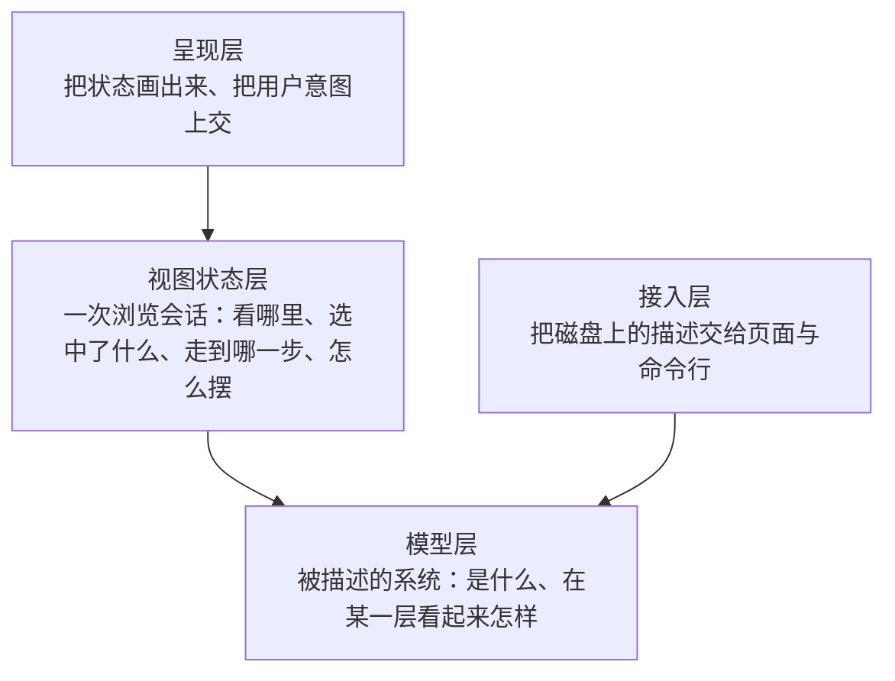

# h5p-arch-desk 架构总览

> 本文回答**系统怎么组成**：设计原则、分层与模块、依赖、技术栈、代码与运行形态。每个模块的机制、数据结构、接口与运行时序在专题文档（§7）里；概念与规则以 [02-domain.md](./02-domain.md) 为准，本文与专题只引用规则编号。
> 本文与专题描述**目标态**；尚未实现的模块标「待实现」，行为已实现但实现位置要调整的标「待重构」。本项目自身的架构描述 `model/h5p-arch-desk/` 反映当前代码（含场景「打开场景并回放」），可在架构台上逐层查看与回放。

## 0. 一句话

**本地架构工作台：看见 · 对照 · 守住。** 看见——AI 把项目代码压缩成模块级的架构描述，工具按层次画成可下钻、可点选、可回放执行链路的图，并让架构迭代先在图上设计评审、再开发；对照——开发服务器读本地源码，把描述与代码事实对照，问题汇总成返工清单交给人或 AI；守住——架构规则、环与棘轮门禁，agent 写前判定。

## 1. 设计原则

1. **描述与渲染分离**。描述文件是唯一真源。AI 生成的部分页面只读；人拥有的内容（评审意见、认可偏差、例外、忽略项）页面只追加，草图可整份覆盖，写后由文件变化推送回来（B1、B6，ADR-0019、ADR-0023）。被描述项目的源码在本地（前提），由开发服务器实时读取，用来对照，不是描述的一部分。描述只有两种来源：AI 按代码生成当前版本；AI 在当前版本上按架构师的草图展开设计版本（ADR-0002，被 ADR-0023 修订）。架构师的意图——草图（`intent/`、`designs/<设计>/sketch.yaml`）与架构规则（`rules.yaml`）——由人定或经设计版本定稿，不随重新生成改动，指纹门禁保证这一点（ADR-0015、X6）。
2. **规则与界面分离**。领域规则写成不依赖 Vue / DOM / 路由 / 计时器的纯函数，按规则清单穷举单测；界面只读状态、只发意图。
3. **每层只算本层**。任何时刻只计算并渲染当前层次的直接子模块与相关的边、帧；模型再大，单屏工作量不变。
4. **出错要说出来**。描述有错时明确报出文件与位置，不静默丢弃；描述来自 AI，错误报告就是给 AI 的返工清单。
5. **依赖单向**。外层依赖内层，内层不感知外层（§2）。
6. **按知识划分层次**。判别法：换一个前端（命令行、导出脚本、AI 查询），这条规则还需要吗？需要的是**关于被描述系统的知识**，放模型层（架构查询）；只在交互浏览时有意义的是**关于一次浏览会话的规则**，放视图状态层（会话规则）。纯不纯是技术属性，不是分层依据。
7. **状态是一个值，规则是纯函数，协调者只有一个**。互相约束的状态不拆成多个 store；状态只经纯的转移函数改变；与外界（路由、文件、布局）的交互由协调者经同步适配器完成，外界始终是状态的投影。

## 2. 分层



| 层 | 抽象原则 | 包含 | 不包含 | 可依赖 |
|---|---|---|---|---|
| 呈现层 | 只读视图状态、只发意图，不做投影、布局与规则计算 | Vue 组件、路由、交互事件、样式 | 投影规则、会话规则、布局算法、文件读取 | 视图状态层、模型层的契约子模块「类型与 Schema」（类型、枚举、名称查询与小谓词，U10） |
| 视图状态层 | 关于一次浏览会话的规则与协调；视图状态是一个值，会话规则是纯函数，协调者负责持有、派生与外界同步 | 视图状态与会话规则、URL 编解码、协调与同步适配器、布局与缓存 | DOM 渲染、关于被描述系统的知识、文件读取 | 模型层 |
| 模型层 | 关于被描述系统的知识，脱离工作台仍成立；输入描述、输出数据，不依赖 Vue / DOM / 布局库 | 描述格式与类型、加载与校验、索引、层次投影、场景投影、架构查询、版本对比、源码归属、架构治理、意图（草图核验）、返工清单 | Vue、DOM、elkjs、文件系统 | — |
| 接入层 | 只搬运文本与做摘要，不解释描述的含义 | 文件读取、人拥有的文件的追加写入与归档、源码文件清单与导出解析、依赖提取、治理存储（基线、拦截记录、指纹）、开发服务器端点、变更通知、命令行、agent 接口（MCP） | 解析规则、文件归属、界面 | 模型层 |

## 3. 模块

第二级模块。「专题」指向说明其机制的文档（§7）。

### 3.1 呈现层

| 模块 | 职责 | 状态 | 专题 |
|---|---|---|---|
| 应用外壳与路由 | 入口与 hash 路由：`/` 项目列表，`/p/<项目>` 当前版本，`/p/<项目>/d/<设计>/<轮次>` 设计版本；切换项目或版本时重建视图 | 已实现 | 工作台 |
| 项目列表（核心） | 项目卡片（健康度为主、规模为次，H-1、Q10；含核心模块的确认计数，Z5）与各项目的设计版本入口（有草图的设计标「偏差 N」，X4） | 已实现 | 工作台 |
| 项目视图（核心） | 一个项目一个版本的工作台：创建并注入协调者，布置顶部栏（含「帮助」打开「怎么读这张图」，W-10）、导航树、画布区（分屏容器：结构图 + 副栏，方向可切换）、属性面板；专注一键收起两侧栏；持有舞台显示（静态关系显示方式、在画布上显示，V8、V9） | 已实现 | 工作台 |
| 副栏 | 分屏的第二块：页签「时序图」「源代码」，收起、切换方向；页签跟随最近的指向，保留预览文件（G15） | 已实现 | 工作台 |
| 版本切换与设计信息条 | 当前版本、各设计的草图与各轮、改动过描述的提交之间切换（E5；草图排在 r1 之前，DV-5）；设计版本的轮次、状态、对比基线、变更计数、标出变更开关、基线漂移；草图版本的「交给 AI」（DV-10）；提交版本的提交说明与对比基线（另一个提交或当前版本，E6） | 已实现 | 工作台 · 加载与版本 |
| 视角切换 | 「结构 ｜ 运行：<场景名>」，进入 / 退出运行视角 | 已实现 | 工作台 |
| 场景列表 | 按层次 / 发起者筛选场景，选定即进入运行视角；有证据文件的标 ✓（S15），有无证据步骤的标「? N」（S17） | 已实现 | 工作台 |
| 导航树 | 左侧「模块」「文件」「步骤」「问题」四个页签：模块树、源代码文件树与步骤树，与画布、时序图同步展开与高亮，单击 / 双击复用导航与回放的操作（T、G13、G14）；模块树标出需复核的模块并可「只看需复核」（Z3） | 已实现 | 工作台 |
| 画布（核心） | 结构图：节点与边、平移缩放、单击 / 双击 / 悬停、聚焦变淡、设计版本变更标记；运行视角下的舞台（按静态关系显示方式隐藏或淡化，V5、V8、V9）、回放叠加；选中步骤时其余走过的边变灰（R15）；结构视角的代码事实叠加：证实标记、代码依赖叠加线、违规描边、本层环（K9、Y4）；右下角「显示」面板（显示设置与图例合一，W-2） | 已实现 | 工作台 · 架构治理 |
| 时序图（核心） | 运行视角下按本层画泳道（按层次排序、同一父模块分组）、消息、组合框；单击消息指向该步，单击 `alt` 分支条件选该分支（F6e）；选中突出：只有选中的消息用选中样式，选中其他对象时突出相关泳道（R15、R16）；泳道头首尾固定，只在用户移动进度时滚动；无证据的消息标「?」（S17） | 已实现 | 工作台 · 场景 |
| 回放控制条 | 上一步 / 下一步、进度、路线总览（F6f）、停在分支点时的分支选择；不提供自动播放 | 已实现 | 工作台 |
| 源代码预览 | 只读显示预览文件的源码：语法高亮、行号；过大、二进制、源码清单读取失败时给提示（G17、G1）；可滚到指定行（S18） | 已实现 | 工作台 |
| 属性面板（核心） | 按选中显示属性：系统、模块（含文件、入口与导出）、关系、聚合边、参与者、文件、场景、步骤（作用、输入、输出在前）、代码依赖叠加线；运行视角下的运行信息；步骤的「代码证据」与场景的「证据」（S15–S18）；结构关系可在画布上显示（V9）；「架构治理」一节（GV-7；选中带环编号的节点时列出所在的本层环及其构成，GV-9、Y5）；「意图」一节（每张活动草图的偏差计数与「查看偏差」，SK-4）；设计面板的草图核验（偏差、「认可偏差（写理由）」、「归档 / 晋升」，DV-11）；信息顺序先职责与交互、细节折叠（§4.3）；在这里发起人拥有的文件的追加写入（加例外、加入忽略、记录评审意见、认可偏差，B1–B4、X4；确认 / 复核并确认，含「自上次确认以来的改动」与「也确认子模块」，Z3、Z4） | 已实现 | 工作台 · 架构治理 |
| 导航 | 面包屑、搜索、显示开关（含「代码事实」，K9） | 已实现 | 工作台 |
| 问题页签 | 导航树「问题」页签：返工清单按严重度排序、筛选、展开、定位、复制给 agent；画布左上角的计数角标（W-6、U9） | 已实现 | 工作台 |
| 呈现共用件 | 多个呈现子系统共用、自身不依赖其他呈现子系统的叶子：界面文案（领域枚举的中文显示名；命令行也要用的规则名属于模型层的契约，U10）、代码高亮（签名与源代码预览共用）、「在副栏预览」的注入键（项目视图提供、面板取用） | 已实现 | 工作台 |

### 3.2 视图状态层

| 模块 | 职责 | 状态 | 专题 |
|---|---|---|---|
| DeskState（核心） | 协调者：持有视图状态、唯一写入口 `dispatch`、派生要画的数据；同步适配器（路由、模型源、布局、源码）；设计版本的对比基线与差异（草图作为版本的一种，对比基线为当前版本，DV-10）；文件归属与源码警告；代码事实同步与治理报告、选中节点所在的本层环（K8、U8、U9、Y5）；确认状态的派生与确认的写入意图（Z3、Z4）；演化事实同步与本层投影、选中的耦合线（J1、J5、J7）；活动草图的核验结果（X4）；步骤的代码证据与场景汇总（S16、S17）。对外核心平铺，领域派生分 `run` / `files` / `versions` / `facts` / `review` / `evolution` / `intent` / `evidence` 八组（ADR-0013） | 已实现 | 视图状态 · 架构治理 |
| 视图状态转移（核心） | 会话规则的纯函数：视角与选中（V）与选中突出（R15、R16）、导航（N）、回放（R、F6c、F6e、V7）、URL 编解码（含文件选中，G16） | 已实现 | 视图状态 |
| Layout（核心） | 结构图排布（分层总览 / elkjs，Worker 中运行，按内容缓存；边界节点按层次顺序，L4）；时序图排布（泳道层次顺序与分组，P9、P13；消息的证据等级，S17）；舞台叠加（走过的边、当前消息、经由上层与未建模的临时线、分支预览的坐标）与舞台显示（哪些节点与边隐藏、淡化、临时显示，V5、V8、V9）；画布场景 `canvasScene`（节点与边的数据、显隐、变淡、回放态与选中突出，ADR-0013；热度角标与耦合线，J5） | 已实现 | 结构投影 · 场景 · 工作台 |

### 3.3 模型层

| 模块 | 职责 | 状态 | 专题 |
|---|---|---|---|
| 类型与 Schema（核心） | 模型层的契约：描述文件的格式（JSON Schema，含顶层键 `sketch`）与各阶段的数据类型声明（加载、索引、投影、版本对比在 `types.ts`，场景投影、源码归属、架构治理、意图、返工清单、确认、演化事实分别在 `scenario/`、`source/`、`governance/`、`intent/`、`rework/`、`review/`、`evolution/` 下的 `types.ts`）、领域枚举、只查表的名称查询与小谓词（`names.ts`：`moduleName`、`isLong`、`RULE_LABELS`；`design.ts`：`isArchived`；`intent/types.ts`：`isSketchFile`、`isOwnedFile`）；不含投影与计算，呈现层对模型层只依赖它（U10） | 已实现 | 加载与版本 |
| 加载流水线（核心） | Loader → Validator → Indexer，入口 `loadModel`；规则 M、S5–S13；草图文件先入、对草图实体的补充与重定义（X1） | 已实现 | 加载与版本 |
| Projector（核心） | 层次投影与分层总览（L、O），端点映射 `mapEndpoint`，最近可见层次，层次顺序 `hierarchyKey`（P9、L4），最近公共祖先 `lowestCommonAncestor`（N3、S9） | 已实现 | 结构投影 |
| 场景投影（核心） | 回放计划（含调用与返回配对 F7、步骤继承关系的接口与数据 S14）、回放路径（含路线与直选分支，F6e、F6f）、帧的层次投影、参与查询、步骤大纲、时序模型（泳道层次顺序与所属，P9、P13）（S、F、P、R7、R13、T5、T6） | 已实现 | 场景 |
| 版本对比 | 设计版本相对对比基线的差异与涉及变更数（E1、E2） | 已实现 | 加载与版本 |
| 源码归属 | 文件按 `codeRefs` 归属模块、未归属与冲突、忽略清单、入口文件、导出与 `provides` 的对应、文件在当前层次的投影、目录树（G3–G14、G18）；路径补全、包入口与说明符解析（K2，入口、导出解析与依赖提取共用） | 已实现 | 源码 |
| 架构治理 | 文件依赖提升为模块依赖、关系证实与未描述依赖（K4–K7）；端口三角（K11）；规则校验、违规与例外（U2–U6）；环与环度（Y）；基线门禁（U8）；本层投影与本层环的构成（K9、Y4、Y5）；agent 查询：定位、写前判定、拦截报告（Q1、Q2、Q4）；步骤的候选调用点与证据等级（S16） | 已实现 | 架构治理 |
| 演化事实 | git 历史提升为模块的修改热度、缺陷热度与时间耦合（J1–J4）；本层投影、热度前 N、无依赖的耦合对（J5、J6、J8）；与架构治理同属第三类事实的对照（ADR-0023） | 已实现 | 演化事实 |
| 意图 | 草图核验 `sketchCheck`（X2、X4）：草图与持久草图的矛盾检查、按口径比对版本、应用认可偏差；归档判定 `archiveVerdict`（一致与否、归档还是晋升，X3）与草图覆盖的模块 `sketchModules`（供确认层写确认记录）；指纹比对 `compareOwned`（X6）。输入是草图定义与模型索引，不碰文件系统 | 已实现 | 架构治理 |
| 返工清单 | 把描述问题、源码归属、代码事实、违规、未建模的步骤、无证据的步骤（S17）、需复核的模块、草图偏差与指纹不符汇总为按根因聚合的返工项，每条带文件行号、规则编号与建议动作；渲染给 agent 的 Markdown（Q7–Q9、Z3）；项目健康度计数（Q10、Z5）。只读其他模型子模块的结果，不新增事实 | 已实现 | 架构治理 |
| 确认 | 人确认层的架构查询：模块的确认摘要与指纹 `reviewHash`（Z2）、确认状态与差异（Z3）、确认范围（Z4）、健康度计数（Z5）；纯函数，页面、命令行与草图归档共用 | 已实现 | 架构治理 |

### 3.4 接入层

| 模块 | 职责 | 状态 | 专题 |
|---|---|---|---|
| ModelSource 插件（核心） | 开发服务器端点（描述与源码）与按项目的变更推送；本工具只有开发服务器这一种运行形态，没有构建态输出（ADR-0007 修订） | 已实现 | 加载与版本 · 源码 |
| 描述读取（核心） | 发现项目与设计版本，读取描述文件（YAML / JSON，含 `intent/`），发现设计的 `sketch.yaml` 并作为版本提供（`system.yaml` + 持久草图 + 草图，附当前版本为对比基线与「交给 AI」的指令，DV-10），为设计各轮附上草图、为当前版本附上已定稿设计的草图（X4），生成项目摘要（含各设计的偏差计数）；开发服务器为摘要附上健康度（`readHealth`：源码清单、代码事实与基线，Q10） | 已实现 | 加载与版本 |
| git 读取 | 列出改动过项目描述的提交、读描述在某个提交时的快照并附对比基线（`git log` / `ls-tree` / `show`，参数不经 shell，E5、E6） | 已实现 | 加载与版本 |
| 描述写入 | 只追加人拥有的内容：评审意见与认可偏差（`design.yaml`）、例外（`rules.yaml`）、忽略项（`source-ignore.yaml`）、确认记录（`reviewed.yaml`，同一模块更新那一条，支持批量，Z1、Z6），用 YAML 文档模型保留注释；归档 / 晋升（改设计状态、晋升时整份替换持久草图、归档时经确认层的 `appendReviewed` 写确认记录，X3）；写后更新指纹（X6）；端点由 ModelSource 插件挂载，只收同源 JSON POST（B1–B6） | 已实现 | 加载与版本 |
| 源码读取 | 解析源码根目录、列出文件清单与包入口、读取单个文件、用 TypeScript 解析导出，端点由 ModelSource 插件挂载（G1、G2、G11、G17） | 已实现 | 源码 |
| 命令行校验 | `npm run lint:model`，含设计版本的每一轮；当前版本附带归属警告（G9）、治理门禁（U8）、指纹比对（X6）与活动草图的核验（X4），读不到源码为错误（G1） | 已实现 | 加载与版本 · 架构治理 |
| 依赖提取 | 用 TypeScript 语法解析提取文件依赖、读 tsconfig paths 并经源码归属的说明符解析（K2）、穿透再导出；按修改时间缓存；端点由 ModelSource 插件挂载（K1–K3） | 已实现 | 架构治理 |
| 源码历史读取 | 读源码仓库的 `git log --numstat`（参数经 execFile），按 HEAD 与窗口缓存，只保留源码清单内的文件；端点 `source/<项目>/history.json` 由 ModelSource 插件挂载（J1） | 已实现 | 演化事实 |
| 治理存储 | 读写项目下 `governance/`：基线（只由命令行生成）、拦截记录（追加）、人拥有文件的指纹 `owned.json`（命令行登记、写入端点更新，X6）；读源码根目录的 git 提交（U7、Q4） | 已实现 | 架构治理 |
| agent 接口 | 查询核心（加载描述、源码、事实，调用模型层；每次查询前比对输入，变了就重建）与两种外壳：命令行 `npm run arch`、MCP 服务器 `npm run arch:mcp`（Q1–Q9，含返工清单 `issues`）；草图核验 `sketch-check` 与归档 `sketch archive`（X3、X4、X8）；命令行另有 `own`（X6） | 已实现 | 架构治理 |

### 3.5 模块边界的判据

- **模型层不 import Vue、DOM、elkjs、文件系统**。
- **呈现层不直接调用模型层的计算**，只读视图状态的派生数据并调用 DeskState 的操作；对模型层只依赖契约子模块「类型与 Schema」（类型、枚举、名称查询与小谓词），由 `rules.yaml` 的依赖白名单校验（U10）。界面文案（枚举的中文显示名）在呈现层的「呈现共用件」。
- **跨呈现子系统共用的件放「呈现共用件」**，它只当叶子、不依赖其他呈现子系统；注入键放共用件而不放提供方，否则取用方依赖提供方、提供方又渲染取用方，成环（Y4）。
- **模型层回答「被描述的系统是什么」，视图状态层回答「用户此刻在看什么」**（原则 6）。例：「重新加载后某个旧层次最近仍存在的祖先」是模型层查询；「重新加载后保不保留选中」是会话规则。
- **Projector 不知道坐标，Layout 不知道层次规则**，两者通过 `LevelView` 交接；场景投影与时序图排布同理，通过 `SequenceModel` 交接。
- **会话规则不碰外界**：路由、文件、布局只出现在同步适配器里。

## 4. 主要依赖

| 关系 | 经由 | 说明 |
|---|---|---|
| 呈现 → DeskState | 派生数据（只读）、`dispatch` 与操作 | 用户意图上交，面板与画布只按 ID 查询显示 |
| DeskState → 视图状态转移 | `transition(state, action, ctx)` | 唯一写入口 |
| 视图状态转移 → 模型层 | 架构查询（`nearestExisting`、`nearestVisibleLevel`、`lowestCommonAncestor`、`stepAfter`、`choicesFor` 等） | 会话规则遇到关于被描述系统的问题一律问模型层 |
| DeskState → 模型层 | `loadModel`、`projectLevel`、`planScenario` / `resolvePath` / `routeOf` / `projectScenario`、`pairReturns`、`participation` / `scenarioModules`、`outlineScenario`、`diffModels` | 派生 |
| DeskState → Layout | `layoutView`（异步，经布局同步适配器）、`layoutSequence`、`stageOverlay`（同步） | 坐标 |
| 画布 → Layout | `canvasScene`（内部调用 `stageDisplay`，显示用的纯函数） | 画布的节点与边，含舞台上每个节点与边隐藏、淡化还是显示（V5、V8、V9）；显示方式与临时显示来自项目视图，不进视图状态 |
| 场景投影 → Projector | `mapEndpoint`、`edgeId`、`hierarchyKey` | 结构图与时序图共用同一套端点规则（P1）与层次顺序（P9、L4） |
| 源码归属 → Projector | `mapEndpoint` | 选中文件在当前层次的投影与帧、关系同一套规则（G14） |
| DeskState → 源码归属 | `assignFiles`、`moduleFiles`、`moduleEntry`、`matchExports`、`fileNodes`、`sourceIssues`、`fileTree` | 派生 |
| 项目视图 → ModelSource | HTTP 端点 `source/<项目>.json`、`source/<项目>/file.json`、`source/<项目>/exports.json`（`httpSourceFetcher`，注入给源码同步） | 与 `fetchModel` 一样，外界地址只在呈现层出现；文件清单与内容按需取，不推送 |
| 命令行校验 → 源码读取、源码归属 | `readSourceTree`、`sourceIssues` | 与页面报出同样的归属警告 |
| 源码读取、依赖提取 → 源码归属 | `resolveRelative`、`specResolver`、`joinPath` | 导出解析（G11）、依赖提取（K2）与入口文件（G10）同一套路径补全与包入口 |
| 命令行校验、agent 接口 → 依赖提取、治理存储、架构治理 | `readCodeDeps`、`readBaseline`、`appendLedger`、`governanceReport`、`checkDependency` | 与页面同一套治理计算（K8、U8、Q6） |
| agent 接口 → 返工清单 | `reworkList`、`reworkMarkdown` | 命令行与 MCP 的 `issues` 同一份结果（Q9） |
| DeskState → 演化事实 | `evolutionStats`、`levelEvolution` | 派生；历史经源码同步按需取（`source/<项目>/history.json`，J1） |
| 演化事实 → 源码归属、架构治理、Projector | `moduleLines`、`within`、`mapEndpoint` | 归属与行数（J2、J3）、有无依赖（J4）与本层投影（J5）复用同一套规则 |
| 返工清单 → 演化事实 | `isolatedCouplings` | 无依赖无关系的耦合对（J6） |
| DeskState、命令行校验、agent 接口 → 意图 | `sketchCheck`、`checkSketches`、`archiveVerdict`、`compareOwned` | 页面、`lint:model` 与 `sketch-check` 同一套核验（X4）；归档前的判定与命令行同一函数（X3） |
| 描述写入 → 意图、确认 | `archiveVerdict`、`sketchModules`、`reviewEntries`（写入用同一文件里确认层的 `appendReviewed`） | 归档时先核验当前版本，一致才写；确认记录的指纹与摘要按确认层的口径，来源 `sketch:<设计 ID>`（X3、Z6） |
| 返工清单 → 加载流水线、源码归属、架构治理、场景投影、意图 | 校验问题、`SourceOwnership`、`GovernanceReport`、`bindRelation`、`SketchCheck` | 只汇总已有结果；未建模的步骤与回放同一套绑定（S13、P11）；草图偏差一条一个根因（X4） |
| 命令行校验、agent 接口 → 治理存储 | `readOwned`、`ownedHashes` | 指纹比对的输入（X6） |
| DeskState → 架构治理 | `governanceReport`、`levelFacts` | 派生；事实经源码同步按需取（`source/<项目>/facts.json`） |
| 架构治理 → 源码归属、Projector | `moduleEntry`、`matchRef`、`mapEndpoint` | 访问面的入口（U4）与本层投影（K9、Y4）复用同一套规则 |
| 接入层 → 模型层 | `loadModel` | 项目摘要与命令行校验 |
| 模型源同步 → ModelSource | HTTP 端点、`arch-model:changed` 事件 | 加载与重新加载 |

## 5. 技术栈

| 关注点 | 选择 | 理由 | 未选 |
|---|---|---|---|
| 框架 / 构建 / 测试 | Vue 3 + Vite + TypeScript + Vitest | 与 h5player-demo 其他包一致 | — |
| 结构图画布 | Vue Flow | 每层只有几十个节点，DOM 渲染足够；节点承载多行文字、标记、计数，写 Vue 组件最直接；平移缩放选中现成。画布封装在 GraphCanvas 后，将来上千节点的视图可局部换实现 | AntV X6（Vue 桥接繁琐）、AntV G6 / Cytoscape（命令式、无 Vue 绑定） |
| 自动布局 | elkjs（layered），Worker 中运行，按需加载，结果按视图内容缓存 | 正交走线、减少交叉，效果优于 dagre | dagre |
| 时序图 | 自研 Vue + SVG | 需要逐步指向、与结构图联动、按层次投影参与者；规则简单（泳道排序、消息累加、组合框包住子消息） | Mermaid（整张 SVG 难以交互，仅可作导出） |
| 描述格式 | YAML（场景也可 JSON，同一解析器）+ JSON Schema（ajv） | 长文本友好、AI 易读写；一份 Schema 同时用于编辑器提示与运行时校验；跨文件引用由 Validator 校验 | — |
| 状态 | Vue `shallowRef` + `computed` 实现「一个值 + 纯转移 + 一个协调者」 | 状态只有一个值、写入口只有一个，Pinia 无额外收益；将来撤销可直接在 `dispatch` 上记录历史 | Pinia |
| 路由 | vue-router（hash 模式） | 层次、选中、场景、步骤进 URL，复制链接即可打开同一画面 | — |
| Markdown / 高亮 | markdown-it（禁用原始 HTML）/ Shiki（按需加载语法：签名用 TS，源代码预览按扩展名加载 TS / TSX / JS / Vue / JSON / YAML / Markdown / CSS / HTML / Shell） | 与签名高亮同一套主题，明暗一致 | marked / highlight.js、Monaco（只读预览用不到编辑器，体积大） |
| 导出解析 | TypeScript 编译器 API（Node 侧，只做语法树，不做类型检查） | 已是开发依赖；语法树足以拿到名称与声明文本，毫秒级 | ts-morph（额外依赖）、类型检查器（慢，依赖工程配置） |
| glob 匹配 | 自研纯函数（`*`、`**`、`?`、`{a,b}`） | 模型层不依赖文件系统与 Node 库；规则简单，可穷举单测 | minimatch / picomatch（需打进页面） |
| MCP 服务器 | `@modelcontextprotocol/sdk`（stdio）+ `zod` | 官方 SDK，Claude Code、Cursor 等 agent 直接接入；只在 Node 侧，不打进页面 | 自写 JSON-RPC（协议细节多） |
| 依赖提取 | TypeScript 编译器 API（只做语法树） | 与导出解析同一套；不依赖工程配置、不做类型检查 | dependency-cruiser（不穿透 barrel 到声明文件，另起一套解析）、类型检查器（慢） |
| 包管理 | npm，独立 `package-lock.json` | 与 auto_test 一致 | — |
| 代码规范 | ESLint（flat config：`@eslint/js`、typescript-eslint、eslint-plugin-vue）+ Prettier（按现有风格） | ESLint 查正确性，Prettier 只管格式，互不重叠（ADR-0013） | 只靠 type-check |
| 浏览器端 E2E | Playwright（`@playwright/test`，本机 Chrome，自带开发服务器） | 覆盖 jsdom 测不到的界面行为；自动等待，对 SVG 友好（ADR-0013） | Cypress、Vitest 浏览器模式 |
| 打包拆分 | 项目视图按路由懒加载；Vue Flow、Markdown、高亮各自成块 | 首页不加载画布（ADR-0013） | — |

依赖版本以 `package.json` 为准，引入时选已发布两周以上的稳定版。

## 6. 开发视图与物理视图

```text
packages/h5p-arch-desk/
  docs/                       需求、领域模型、架构（总览 + architecture/ 专题）、描述格式、ADR
  schema/arch-file.schema.json  描述文件格式的真源
  model/<项目>/               各项目的架构描述（ADR-0001）；intent/ 下为持久草图（骨架 skeleton.yaml，ADR-0023）；designs/ 下为设计版本（ADR-0002），每个设计可有 sketch.yaml
  vite/                       接入层：archModelPlugin.ts（端点与推送）、readModelDir.ts（读取与摘要，含草图版本）、readGit.ts（描述的 git 历史）、readHealth.ts（健康度）、writeModel.ts（人拥有的文件的追加写入与归档）、
                              readSource.ts（源码根目录、文件清单、文件、导出）、readDeps.ts（依赖提取）、
                              governanceStore.ts（基线、拦截记录与指纹）、readHistory.ts（源码历史读取）
  scripts/lint-model.ts       命令行校验
  scripts/agent/service.ts    agent 接口的查询核心；scripts/arch.ts（命令行）、scripts/arch-mcp.ts（MCP 服务器）
  model/<项目>/governance/    基线 baseline.json、拦截记录 ledger.jsonl 与人拥有文件的指纹 owned.json（不属于描述，ADR-0015、ADR-0023）
  src/
    model/                    模型层：types · names · load · validate · indexer · project · diff · design
      scenario/               场景投影：types（契约）· bind · steps · plan · path · level · participation · outline · sequence
      source/                 源码归属：types（契约）· glob · ownership（归属、入口、导出对应、投影、目录树）
      governance/             架构治理：types · facts · rules · cycles · report · level · query · ledger · ports
      intent/                 意图：types（契约：草图定义、偏差、isSketchFile、isOwnedFile）· check（sketchCheck、矛盾检查）· lifecycle（archiveVerdict、sketchModules）· owned（compareOwned）
      rework/                 返工清单：types（契约）· list · markdown
      evolution/              演化事实：types（契约）· history · level
    state/                    视图状态层：useDeskState（协调者）· inject
      transition/             会话规则：types · navigation · selected · playback · url
      desk/                   DeskState 的分组派生：run · files · versions · facts · review · evolution · intent
      sync/                   同步适配器：router · modelSource · layout · source
    layout/                   layout.ts（结构图）· sequence.ts（时序图）· stage.ts（舞台叠加与显示）· canvas.ts（画布场景）
    components/               呈现层（专题「工作台」列出组件分工）
  tests/                      单测（按层组织）、验收与 fixtures
  e2e/                        浏览器端 E2E（Playwright）
```

| 形态 | 描述从哪来 | 用途 |
|---|---|---|
| `npm run dev` | 实时读取 `model/`（`ARCH_MODEL_ROOT` 可覆盖），文件变化按项目推送刷新；源码按 G1 从本地源码根目录实时读取（不监听变化，进入项目、描述刷新或手动刷新时重新列出） | 本地查看；AI 改描述后立刻看到 |
| `npm run build` | 类型检查后打包，不读描述、不输出描述与源码 | 打包验证（分块、Worker、按需加载能打成产物）；产物不部署 |
| `npm run lint:model` | 同开发服务器的读取方式，逐项目、逐设计轮次校验；当前版本附带归属警告与治理门禁 | CI 与 AI 自检 |

## 7. 专题

| 专题 | 回答的问题 | 覆盖模块 |
|---|---|---|
| [描述加载与版本](./architecture/loading-and-versions.md) | 描述文件怎么变成可查询的模型；设计版本怎么读、怎么对比 | ModelSource 插件、描述读取、命令行校验、类型与 Schema、加载流水线、版本对比 |
| [结构投影与布局](./architecture/projection.md) | 某一层要画什么、怎么摆 | Projector、Layout（结构图） |
| [视图状态与协调](./architecture/view-state.md) | 用户此刻在看什么、操作怎么改变它、怎么与路由 / 文件 / 布局保持一致 | DeskState、视图状态转移 |
| [场景投影与回放](./architecture/scenario.md) | 一个场景在某一层怎么走、单步与跳转怎么算 | 场景投影、时序图排布 |
| [源码接入与归属](./architecture/source.md) | 源码从哪读、文件属于哪个模块、入口导出什么、与描述对不对得上 | 源码读取、源码归属 |
| [架构治理](./architecture/governance.md) | 代码依赖从哪来、描述对不对、规则怎么判、门禁怎么卡、agent 怎么问；草图怎么核验、归档，指纹怎么比 | 依赖提取、治理存储、agent 接口、架构治理、意图 |
| [演化事实](./architecture/evolution.md) | git 历史从哪读、怎么提升为模块的热度与时间耦合、怎么叠加 | 源码历史读取、演化事实 |
| [工作台界面](./architecture/workbench.md) | 页面怎么布置、每个组件画什么、交互意图怎么上交 | 呈现层全部 |

## 8. 价值如何涌现

```text
项目代码（成千上万行）
  │  AI 生成：去掉函数、文件这一级，只留模块、职责、接口、关系、场景 —— 压缩信息量
  ▼
架构描述 ── Loader + Validator：引用完整，图上不会出现断线 —— 可信
  ▼
模型索引 ── Projector：先给分层总览，之后一次只给一层，深层关系提升为聚合边 —— 分层屏蔽又不丢联系
         └ 场景投影：同一条执行链路在每一层都有对应粒度的时序 —— 看见运行
  ▼
导航树 + 画布 + 时序图 + 面板 ── 目录定位、下钻、指向、逐步回放：需要细节时才展开 —— 由架构师决定看多深
  ▲
源码归属 ── 文件按 codeRefs 归属模块、入口导出与接口对照：图上的模块能落到真实文件，描述漏写的文件会报出来 —— 图与代码互相印证
  ▲
代码事实 ── 依赖提取 + 架构治理：关系被代码证实，规则默认拒绝、环度只许下降，agent 写前判定 —— 意图不被侵蚀
  ▼
架构师脑中的分层结构与运行路径
  │  草图：架构师只画核心与骨架，AI 展开其余；核验让草图成为 AI 不能违背的约束，归档把它转成「已理解」 —— 意图不被重新生成侵蚀
  │  设计版本：在当前架构上按草图展开、标出变更、多轮评审 —— 先在图上演进，再改代码
```

拿掉任意一环的后果：没有 AI 生成，描述很快过时；没有 Validator，图上出现断线、不再可信；没有分层投影，几百个节点平铺看不清；没有聚合边，高层看起来模块互不相关；没有场景投影，只能看到「谁连谁」看不到「依次怎么走」；没有设计版本，架构评审只能对着代码或文字进行；没有代码事实与门禁，描述与规则只是愿望，agent 会一点点把结构腐蚀成大泥球。
