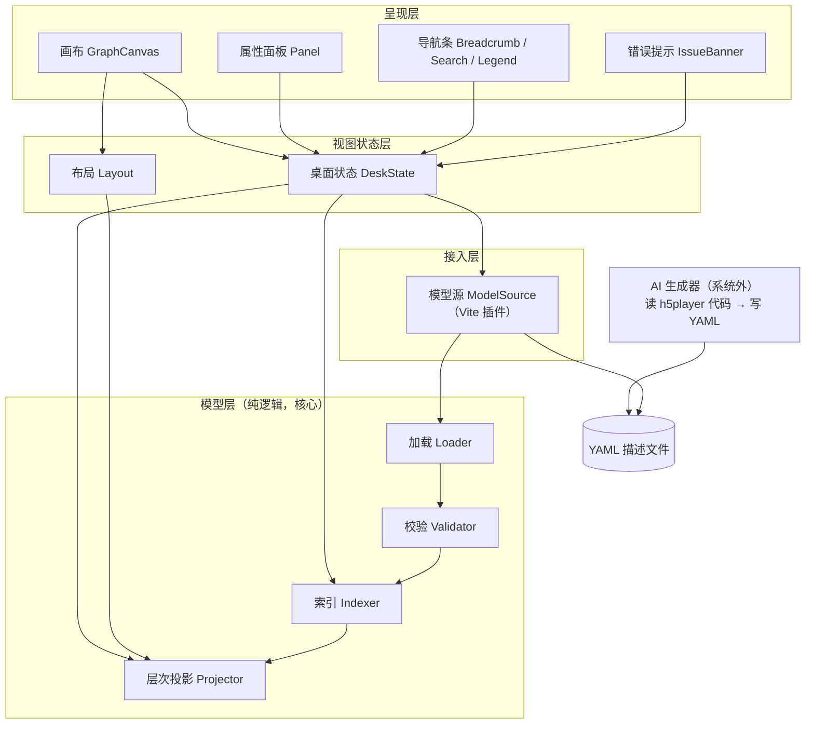
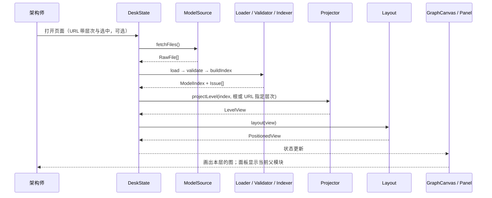
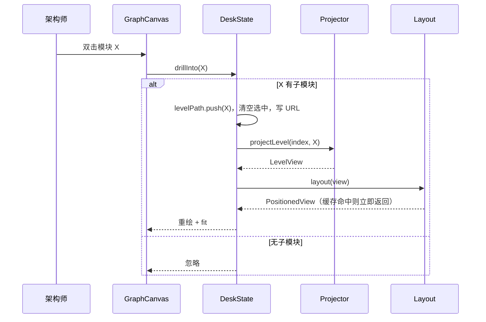
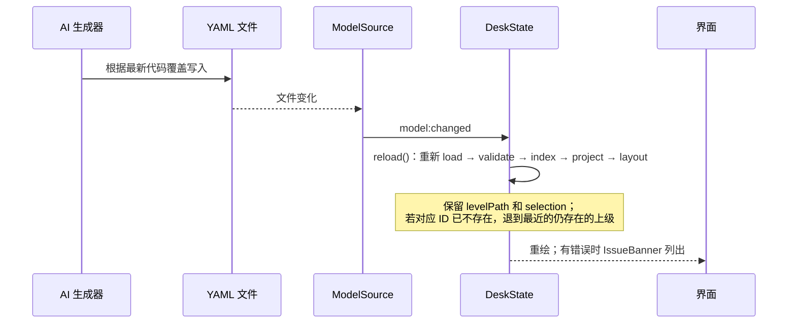

# h5p-arch-desk 架构文档

> 状态：v1.0 定档（2026-10-19），范围：一期（只看结构，不做时序回放、不做一致性校验）
> 相关：[01-requirements.md](./01-requirements.md) · [02-tech-selection.md](./02-tech-selection.md)

---

## 0. 一句话

**AI 把 h5player 的代码压缩成模块级的 YAML 描述，h5p-arch-desk 把这份描述按层次画成可下钻、可点选的图。** 架构师只和图打交道，不和代码打交道。

本文按 4+1 视图的思路组织，但只保留有用的部分：

| 视图 | 回答的问题 | 本文章节 |
|---|---|---|
| 逻辑视图 | 有哪些模块、各管什么、怎么依赖 | §2 §3 §4 |
| 过程视图 | 运行时谁先谁后调用谁 | §5 |
| 开发视图 | 模块落在哪些目录 | §6 |
| 物理视图 | 跑在哪里 | §6 |
| 场景（+1） | 上面这些如何合起来产生价值 | §7 |

## 1. 设计原则

1. **描述与渲染分离**。YAML 是唯一真源，页面只读不写。描述的变化只有一种方式：AI 重新根据代码生成 YAML。
2. **规则与界面分离**。"一层看什么、深层关系怎么提升成聚合边"是本工具的核心规则，写成不依赖 Vue 的纯函数，可以单独测试、单独替换界面。
3. **每层只算本层**。任何时刻只计算并渲染当前层次的直接子模块和相关的边。层次再深、模型再大，单屏的工作量也不变。
4. **出错要说出来**。描述文件有错误时（引用不存在、ID 重复），明确报出文件和位置，不静默丢弃。因为描述来自 AI，错误报告就是给 AI 的返工清单。
5. **依赖单向**。外层依赖内层，内层不感知外层（见 §3）。

## 2. 层次与模块

自外向内分四层，外加一个系统外的生产者：



### 2.1 模块清单

| 模块 | 层 | 职责（只做什么） | 核心数据结构 | 对外接口 |
|---|---|---|---|---|
| **ModelSource** | 接入 | 找到模型根目录下的项目并读取其 YAML；生成项目摘要；开发态监听文件变化并按项目通知页面；构建态固化为静态文件 | `RawFile { path, text }`、`ModelPayload`、`ProjectSummary` | `GET projects.json`、`GET models/<项目>.json`，事件 `arch-model:changed { project }` |
| **Loader** | 模型 | 解析 YAML、按 JSON Schema 检查单文件格式、把多个文件合并成一个模型 | `ArchModel { modules, relations, interfaces, dataStructures }` | `load(files) → { model, issues }` |
| **Validator** | 模型 | 跨文件检查：ID 唯一、引用存在、祖先与后代之间不连边 | `Issue { severity, file, path, line, code, message }` | `validate(model) → { model, issues }`：error 级问题的实体被剔除，warning 级只去掉坏引用 |
| **Indexer** | 模型 | 建立查询结构，让后续按 ID 查询都是 O(1) | `ModelIndex { byId, parentOf, childrenOf, ancestorsOf, relationsOf }` | `buildIndex(model) → ModelIndex` |
| **Projector** | 模型 | 给定一个层次，算出这一层的节点、直接边、聚合边、边界节点；子模块都是层时，额外算出分层总览 | `LevelView { mode: graph\|layered, parent, nodes, edges, boundaries, bands? }`；`Edge { kind: direct\|aggregate, from, to, type, relationIds[] }`；`Band { layerId, order, abstraction, mayDependOn, coreModules[], hiddenCount }` | `projectLevel(index, levelId, opts) → LevelView` |
| **Layout** | 视图状态 | 给 `LevelView` 的节点算坐标。`graph` 模式用 elkjs（在 Worker 中运行）只排内部模块与内部边，边界节点排在下方一行、边界边画成曲线（聚焦时才显示）；`layered` 模式按层序分带排布，带内核心模块横向排开，不调用 elk。结果按层次缓存 | `PositionedView { view, positions }` | `layout(view) → Promise<PositionedView>` |
| **DeskState** | 视图状态 | 每个项目一份：持有当前层次、选中对象、显示开关；与 URL（`/p/<项目>?level=&sel=`）同步，只响应本项目路由；对外提供唯一的一组操作 | `DeskState { levelPath[], selection, toggles, issues }` | `drillInto(id)` `goTo(levelId)` `select(ref)` `clearSelection()` `reload()` |
| **GraphCanvas** | 呈现 | 把 `PositionedView` 画成节点和边；`layered` 模式下层画成分组节点（带），核心模块作为带的子节点；处理平移、缩放、单击、双击、悬停 | Vue Flow 的节点（含父子分组）和边 | 发出 `select` / `drill` / `hover` 意图给 DeskState |
| **Panel** | 呈现 | 按选中对象的类型显示属性：模块、关系、聚合边，或无选中时显示当前父模块 | — | 只读 DeskState + ModelIndex |
| **Nav** | 呈现 | 面包屑返回、搜索跳转、图例、显示开关 | — | 调用 DeskState 的操作 |
| **IssueBanner** | 呈现 | 列出 `issues`，点击展开文件和位置 | — | 只读 DeskState |

### 2.2 模块边界的判据

- **模型层不 import Vue、DOM、elkjs**。输入数据，输出数据。
- **呈现层不直接调用模型层的计算**。它只读 DeskState 并发出操作意图，避免投影规则散落在组件里。
- **Projector 不知道坐标，Layout 不知道层次规则**。两者通过 `LevelView` 交接。

## 3. 模块间关系

| 关系 | 类型 | 经由接口 | 交换的数据 | 说明 |
|---|---|---|---|---|
| ModelSource → Loader | 调用 | `load(files)` | `RawFile[]` → `ArchModel` | 文本变成结构 |
| Loader → Validator | 调用 | `validate(model)` | `ArchModel` → 修剪后的 `ArchModel` + `Issue[]` | 有错也继续往下走，坏的实体和引用被剔除 |
| Validator → Indexer | 数据 | `buildIndex(model)` | `ArchModel` → `ModelIndex` | 一次加载只建一次 |
| DeskState → Projector | 调用 | `projectLevel` | `ModelIndex + levelId` → `LevelView` | 每次切换层次或改动开关时调用 |
| DeskState → Layout | 调用 | `layout(view)` | `LevelView` → `PositionedView` | 异步，命中缓存时立即返回 |
| GraphCanvas → DeskState | 调用 | `select` / `drillInto` | 节点或边的 ID | 用户意图上交 |
| Panel / Nav → DeskState | 读取 + 调用 | 状态读取、`goTo` / `select` | ID | 面板里的链接也走同一组操作 |
| ModelSource → DeskState | 事件 | `arch-model:changed` | `{ project }` | 本项目变化时触发 `reload()` |
| ModelSource → ProjectList | 调用 + 事件 | `projects.json`、`arch-model:changed` | `ProjectSummary[]` | 首页展示项目摘要，任一项目变化时刷新 |

依赖方向：**呈现 → 视图状态 → 模型 ← 接入**。模型层是中心，谁都不依赖。

## 4. 核心规则：层次投影

这是本系统唯一"有知识含量"的计算，全部放在 Projector 里。给定当前父模块 P：

1. 节点 = P 的直接子模块。
2. 对每条关系 `a → b`，分别找出 a、b 在 P 下所属的直接子模块 A、B（不在 P 下的记为外部）：
   - A、B 都存在且 A ≠ B：如果 a、b 本身就是 A、B，画**直接边**；否则并入 `A → B` 的**聚合边**（按方向和类型分组，记录原始关系 ID）。
   - A = B：属于更深层次，不画。
   - 一端在外部：生成**边界节点**，边连到边界节点（受开关控制）。
3. 同一对节点之间的关系合并成一条边：分层总览按 (from, to, type) 分开；普通层次按 (from, to) 合并，记录各类型条数（`mergeTypes`）。
4. 输出 `LevelView`。

**分层总览**：如果 P 的直接子模块全部是 `kind: layer`，则 `mode = layered`，并且额外处理以下几点：

- 按 `order` 生成 `bands`，每条带带上 `abstraction`、`mayDependOn`，以及该层下 `core: true` 的子模块，其余子模块计入 `hiddenCount`。
- 层与层之间的边照上面的规则算出，作为带间的聚合边。
- 再对每个核心模块算一次它的跨层关系，端点提升到对方层内的核心模块；对方不是核心模块时，提升到对方所在的层。这些边默认隐藏，悬停或选中时由界面显示。

这样「一张图看全貌」仍然只是 Projector 的一种输出，不会在界面里多出一套规则。

复杂度：一次投影遍历一遍关系，`O(关系数 × 层深)`，千级模块下是毫秒级。

## 5. 运行时序（过程视图）

### 5.0 首页：选择项目

首页（`/`）由 ProjectList 读取 `projects.json` 渲染项目卡片。点击卡片进入 `/p/<项目>`，路由按项目 ID 重建 DeskView；DeskView 在自身作用域内创建该项目的 DeskState 并注入，离开项目时随组件销毁。之后的流程即 §5.1 起，`fetchFiles()` 读取的是 `models/<项目>.json`。

### 5.1 启动：从文件到第一屏



### 5.2 双击下钻



返回上级（面包屑、Esc、浏览器后退）走 `goTo(levelId)`，流程相同。

### 5.3 选中

单击节点或边时，调用 `select(ref)`，DeskState 更新 `selection` 并写入 URL。Panel 按 ref 类型到 ModelIndex 里查询并渲染。这一路不重新投影，也不重新布局。

选中聚合边时，面板列出它的 `relationIds`。点其中一条，先 `goTo(那条关系两端的最近公共父模块)`，再 `select(该关系)`。

### 5.4 代码变化后 AI 重新生成描述



## 6. 开发视图与物理视图

```text
packages/h5p-arch-desk/
  vite/archModelPlugin.ts      ModelSource
  schema/                      Loader 用的 JSON Schema
  src/model/                   Loader · Validator · Indexer · Projector（纯逻辑，单测重点）
  src/layout/                  Layout（elk Worker）
  src/state/                   DeskState
  src/components/              ProjectList · DeskView · GraphCanvas · Panel · Nav · IssueBanner
  model/<项目>/                各项目架构描述（ADR-0001）：h5player、h5p-arch-desk 自身
```

运行形态只有两种，都不需要后端：

| 形态 | 描述从哪来 | 用途 |
|---|---|---|
| `npm run dev` | 实时读取 `model/`（可用 `ARCH_MODEL_ROOT` 覆盖）下各项目的 YAML，文件变化后自动刷新 | 本地查看；AI 重新生成后立刻看到 |
| `npm run build` | 打包时把项目摘要与各项目 YAML 固化成 `projects.json`、`models/<项目>.json`，输出静态站点 | 内网部署，团队共享某个版本的架构视图 |

## 7. 价值如何涌现（+1 场景）

单看任何一个模块都没有价值：YAML 只是文本，Projector 只是一个函数，画布只是一个画图组件。价值来自一条链路，每一环都在为人脑减负：

```text
h5player 代码（成千上万行）
  │  AI 生成器：去掉函数、文件这一级，只留模块、职责、接口、关系 —— 压缩信息量
  ▼
YAML 描述
  │  Loader + Validator：保证引用完整，图上不会出现断线 —— 保证可信
  ▼
ModelIndex
  │  Projector：根层先给分层总览（几层、各层原则、层间依赖、核心模块）—— 先看全貌
  │            之后一次只给一层，深层关系提升为聚合边 —— 分层屏蔽，又不丢联系
  ▼
LevelView（十几个节点）
  │  Layout：按依赖方向排开，减少交叉 —— 变成一眼能读的图
  ▼
画布 + 面板
  │  下钻 / 选中：需要细节时才展开 —— 由架构师决定看多深
  ▼
架构师脑中的分层结构
```

### 7.1 拿掉任意一环会怎样

| 拿掉 | 后果 |
|---|---|
| AI 生成器 | 没有人愿意手写和维护，描述很快过时，或者根本不存在 |
| Validator | 图上出现指向不存在模块的边，架构师不再相信这张图 |
| Projector 的分层 | 所有模块平铺在一张图上，几百个节点，看不清 |
| Projector 的聚合边 | 高层看起来模块之间互不相关，结构感知是错的 |
| Layout | 节点堆在一起，需要人去摆位置 |
| 下钻和面板 | 只能看到名字和连线，不知道模块管什么、接口长什么样 |

### 7.2 架构师由此得到什么

- **几秒内回答结构问题**：某个模块负责什么、对外提供什么、被谁依赖、和谁交换什么数据。不需要翻代码和多份文档。
- **在任意层次做判断**：在根层看分层是否合理、依赖方向是否正确；下钻一层看子系统内部的职责划分。每层只需要面对十几个节点。
- **跟上代码的变化**：代码变了，AI 重新生成描述，图随之更新。架构师看到的总是接近当前代码的结构，而不是半年前写的文档。
