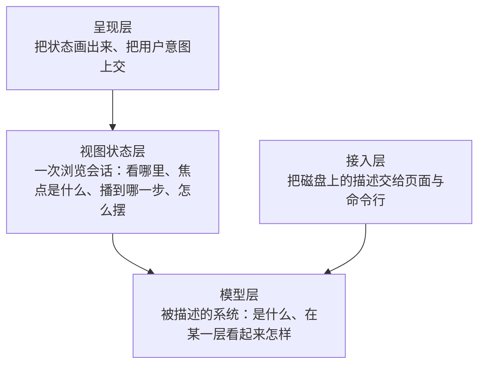

# h5p-arch-desk 架构总览

> 本文回答**系统怎么组成**：设计原则、分层与模块、依赖、技术栈、代码与运行形态。每个模块的机制、数据结构、接口与运行时序在专题文档（§7）里；概念与规则以 [02-domain.md](./02-domain.md) 为准，本文与专题只引用规则编号。
> 本文与专题描述**目标态**；尚未实现的模块标「待实现」，行为已实现但实现位置要调整的标「待重构」。本项目自身的架构描述 `model/h5p-arch-desk/` 反映当前代码（含场景「打开场景并回放」），可在架构台上逐层查看与回放。

## 0. 一句话

**AI 把项目代码压缩成模块级的架构描述，h5p-arch-desk 把描述按层次画成可下钻、可点选、可回放执行链路的图，并让架构迭代先在图上设计评审、再开发。** 架构师只和图打交道，不和代码打交道。

## 1. 设计原则

1. **描述与渲染分离**。描述文件是唯一真源，页面只读不写（包括忽略清单，ADR-0007）。被描述项目的源码只在开发态实时读取，用来对照，不是描述的一部分。描述只有两种来源：AI 按代码生成当前版本；AI 在当前版本上起草设计版本（ADR-0002）。
2. **规则与界面分离**。领域规则写成不依赖 Vue / DOM / 路由 / 计时器的纯函数，按规则清单穷举单测；界面只读状态、只发意图。
3. **每层只算本层**。任何时刻只计算并渲染当前层次的直接子模块与相关的边、帧；模型再大，单屏工作量不变。
4. **出错要说出来**。描述有错时明确报出文件与位置，不静默丢弃；描述来自 AI，错误报告就是给 AI 的返工清单。
5. **依赖单向**。外层依赖内层，内层不感知外层（§2）。
6. **按知识划分层次**。判别法：换一个前端（命令行、导出脚本、AI 查询），这条规则还需要吗？需要的是**关于被描述系统的知识**，放模型层（架构查询）；只在交互浏览时有意义的是**关于一次浏览会话的规则**，放视图状态层（会话规则）。纯不纯是技术属性，不是分层依据。
7. **状态是一个值，规则是纯函数，协调者只有一个**。互相约束的状态不拆成多个 store；状态只经纯的转移函数改变；与外界（路由、文件、布局）的交互由协调者经同步适配器完成，外界始终是状态的投影。

## 2. 分层



| 层 | 抽象原则 | 包含 | 不包含 | 可依赖 |
|---|---|---|---|---|
| 呈现层 | 只读视图状态、只发意图，不做投影、布局与规则计算 | Vue 组件、路由、交互事件、样式 | 投影规则、会话规则、布局算法、文件读取 | 视图状态层、模型层（仅类型与显示用的纯函数） |
| 视图状态层 | 关于一次浏览会话的规则与协调；视图状态是一个值，会话规则是纯函数，协调者负责持有、派生与外界同步 | 视图状态与会话规则、URL 编解码、协调与同步适配器、布局与缓存 | DOM 渲染、关于被描述系统的知识、文件读取 | 模型层 |
| 模型层 | 关于被描述系统的知识，脱离工作台仍成立；输入描述、输出数据，不依赖 Vue / DOM / 布局库 | 描述格式与类型、加载与校验、索引、层次投影、场景投影、架构查询、版本对比 | Vue、DOM、elkjs、文件系统 | — |
| 接入层 | 只搬运文本与做摘要，不解释描述的含义 | 文件读取、源码文件清单与导出解析、开发服务器端点、变更通知、构建产物、命令行 | 解析规则、文件归属、界面 | 模型层 |

## 3. 模块

第二级模块。「专题」指向说明其机制的文档（§7）。

### 3.1 呈现层

| 模块 | 职责 | 状态 | 专题 |
|---|---|---|---|
| 应用外壳与路由 | 入口与 hash 路由：`/` 项目列表，`/p/<项目>` 当前版本，`/p/<项目>/d/<设计>/<轮次>` 设计版本；切换项目或版本时重建视图 | 已实现 | 工作台 |
| 项目列表（核心） | 项目卡片与各项目的设计版本入口 | 已实现 | 工作台 |
| 项目视图（核心） | 一个项目一个版本的工作台：创建并注入协调者，布置顶部栏、导航树、画布区（分屏容器：结构图 + 副栏，方向可切换）、属性面板（固定 / 浮动）；专注一键收起两侧栏；持有舞台显示（静态关系显示方式、在画布上显示，V8、V9） | 已实现 | 工作台 |
| 副栏 | 分屏的第二块：页签「时序图」「源代码」，收起、切换方向；页签跟随最近的指向，保留预览文件（G15） | 已实现 | 工作台 |
| 版本切换与设计信息条 | 当前版本与各设计各轮之间切换；设计版本的轮次、状态、对比基线、变更计数、标出变更开关、基线漂移 | 已实现 | 工作台 · 加载与版本 |
| 视角切换 | 「结构 ｜ 运行：<场景名>」，进入 / 退出运行视角 | 已实现 | 工作台 |
| 场景列表 | 按层次 / 发起者筛选场景，选定即进入运行视角 | 已实现 | 工作台 |
| 导航树 | 左侧「模块」「文件」「步骤」三个页签：模块树、源代码文件树与步骤树，与画布、时序图同步展开与高亮，单击 / 双击复用导航与回放的操作（T、G13、G14） | 已实现 | 工作台 |
| 画布（核心） | 结构图：节点与边、平移缩放、单击 / 双击 / 悬停、聚焦变淡、设计版本变更标记；运行视角下的舞台（按静态关系显示方式隐藏或淡化，V5、V8、V9）、回放叠加与焦点突出（R15） | 已实现 | 工作台 |
| 时序图（核心） | 运行视角下按本层画泳道（按层次排序、同一父模块分组）、消息、组合框；单击消息指向该步，单击 `alt` 分支条件选该分支（F6e）；焦点突出（R15）；悬停泳道头或消息弹出信息卡 | 已实现 | 工作台 · 场景 |
| 回放控制条 | 上一步 / 下一步、进度、路线总览（F6f）、停在分支点时的分支选择；不提供自动播放 | 已实现 | 工作台 |
| 源代码预览 | 只读显示预览文件的源码：语法高亮、行号；过大、二进制、源码不在本地时给提示（G17） | 已实现 | 工作台 |
| 属性面板（核心） | 按焦点显示属性：系统、模块（含文件、入口与导出）、关系、聚合边、参与者、文件、场景、步骤（作用、输入、输出在前）；运行视角下的运行信息；结构关系可在画布上显示（V9） | 已实现 | 工作台 |
| 导航 | 面包屑、搜索、显示开关、图例 | 已实现 | 工作台 |
| 问题提示 | 列出描述的错误与提醒，定位到文件与行号 | 已实现 | 工作台 |

### 3.2 视图状态层

| 模块 | 职责 | 状态 | 专题 |
|---|---|---|---|
| DeskState（核心） | 协调者：持有视图状态、唯一写入口 `dispatch`、派生要画的数据；同步适配器（路由、模型源、布局、源码）；设计版本的对比基线与差异；文件归属与源码警告 | 已实现 | 视图状态 |
| 视图状态转移（核心） | 会话规则的纯函数：视角与焦点（V）与焦点突出（R15）、导航（N）、回放（R、F6c、F6e、V7）、URL 编解码（含文件选中，G16） | 已实现 | 视图状态 |
| Layout（核心） | 结构图排布（分层总览 / elkjs，Worker 中运行，按内容缓存；边界节点按层次顺序，L4）；时序图排布（泳道层次顺序与分组，P9、P13）；舞台叠加（走过的边、当前消息、未建模临时线、分支预览的坐标）与舞台显示（哪些节点与边隐藏、淡化、临时显示，V5、V8、V9） | 已实现 | 结构投影 · 场景 |

### 3.3 模型层

| 模块 | 职责 | 状态 | 专题 |
|---|---|---|---|
| 类型与 Schema（核心） | 描述文件的格式（JSON Schema）与各阶段数据类型 | 已实现 | 加载与版本 |
| 加载流水线（核心） | Loader → Validator → Indexer，入口 `loadModel`；规则 M、S5–S13 | 已实现 | 加载与版本 |
| Projector（核心） | 层次投影与分层总览（L、O），端点映射 `mapEndpoint`，最近可见层次，层次顺序 `hierarchyKey`（P9、L4） | 已实现 | 结构投影 |
| 场景投影（核心） | 回放计划（含调用与返回配对，F7）、回放路径（含路线与直选分支，F6e、F6f）、帧的层次投影、参与查询、步骤大纲、时序模型（泳道层次顺序与所属，P9、P13）（S、F、P、R7、R13、T5、T6） | 已实现 | 场景 |
| 版本对比 | 设计版本相对对比基线的差异与涉及变更数（E1、E2） | 已实现 | 加载与版本 |
| 源码归属 | 文件按 `codeRefs` 归属模块、未归属与冲突、忽略清单、入口文件、导出与 `provides` 的对应、文件在当前层次的投影、目录树（G3–G14、G18） | 已实现 | 源码 |

### 3.4 接入层

| 模块 | 职责 | 状态 | 专题 |
|---|---|---|---|
| ModelSource 插件（核心） | 开发态端点（描述与源码）与按项目的变更推送；构建态输出描述的静态文件（不含源码） | 已实现 | 加载与版本 · 源码 |
| 描述读取（核心） | 发现项目与设计版本，读取描述文件（YAML / JSON），生成项目摘要 | 已实现 | 加载与版本 |
| 源码读取 | 解析源码根目录、列出文件清单与包入口、读取单个文件、用 TypeScript 解析导出，端点由 ModelSource 插件挂载（G1、G2、G11、G17） | 已实现 | 源码 |
| 命令行校验 | `npm run lint:model`，含设计版本的每一轮；源码在本地时附带当前版本的归属警告（G9） | 已实现 | 加载与版本 |

### 3.5 模块边界的判据

- **模型层不 import Vue、DOM、elkjs、文件系统**。
- **呈现层不直接调用模型层的计算**，只读视图状态的派生数据并调用 DeskState 的操作。
- **模型层回答「被描述的系统是什么」，视图状态层回答「用户此刻在看什么」**（原则 6）。例：「重新加载后某个旧层次最近仍存在的祖先」是模型层查询；「重新加载后保不保留选中」是会话规则。
- **Projector 不知道坐标，Layout 不知道层次规则**，两者通过 `LevelView` 交接；场景投影与时序图排布同理，通过 `SequenceModel` 交接。
- **会话规则不碰外界**：路由、文件、布局只出现在同步适配器里。

## 4. 主要依赖

| 关系 | 经由 | 说明 |
|---|---|---|
| 呈现 → DeskState | 派生数据（只读）、`dispatch` 与操作 | 用户意图上交，面板与画布只按 ID 查询显示 |
| DeskState → 视图状态转移 | `transition(state, action, ctx)` | 唯一写入口 |
| 视图状态转移 → 模型层 | 架构查询（`nearestExisting`、`nearestVisibleLevel`、`stepAfter`、`choicesFor` 等） | 会话规则遇到关于被描述系统的问题一律问模型层 |
| DeskState → 模型层 | `loadModel`、`projectLevel`、`planScenario` / `resolvePath` / `routeOf` / `projectScenario`、`pairReturns`、`participation` / `scenarioModules`、`outlineScenario`、`diffModels` | 派生 |
| DeskState → Layout | `layoutView`（异步，经布局同步适配器）、`layoutSequence`、`stageOverlay`（同步） | 坐标 |
| 画布 → Layout | `stageDisplay`（显示用的纯函数） | 舞台上每个节点与边隐藏、淡化还是显示（V5、V8、V9）；显示方式与临时显示来自项目视图，不进视图状态 |
| 场景投影 → Projector | `mapEndpoint`、`edgeId`、`hierarchyKey` | 结构图与时序图共用同一套端点规则（P1）与层次顺序（P9、L4） |
| 源码归属 → Projector | `mapEndpoint` | 选中文件在当前层次的投影与帧、关系同一套规则（G14） |
| DeskState → 源码归属 | `assignFiles`、`moduleFiles`、`moduleEntry`、`matchExports`、`fileNodes`、`sourceIssues`、`fileTree` | 派生 |
| 项目视图 → ModelSource | HTTP 端点 `source/<项目>.json`、`source/<项目>/file.json`、`source/<项目>/exports.json`（`httpSourceFetcher`，注入给源码同步） | 与 `fetchModel` 一样，外界地址只在呈现层出现；文件清单与内容按需取，不推送 |
| 命令行校验 → 源码读取、源码归属 | `readSourceTree`、`sourceIssues` | 与页面报出同样的归属警告 |
| 接入层 → 模型层 | `loadModel` | 项目摘要与命令行校验 |
| 模型源同步 → ModelSource | HTTP 端点、`arch-model:changed` 事件 | 加载与重新加载 |

## 5. 技术栈

| 关注点 | 选择 | 理由 | 未选 |
|---|---|---|---|
| 框架 / 构建 / 测试 | Vue 3 + Vite + TypeScript + Vitest | 与 h5player-demo 其他包一致 | — |
| 结构图画布 | Vue Flow | 每层只有几十个节点，DOM 渲染足够；节点承载多行文字、标记、计数，写 Vue 组件最直接；平移缩放选中现成。画布封装在 GraphCanvas 后，将来上千节点的视图可局部换实现 | AntV X6（Vue 桥接繁琐）、AntV G6 / Cytoscape（命令式、无 Vue 绑定） |
| 自动布局 | elkjs（layered），Worker 中运行，按需加载，结果按视图内容缓存 | 正交走线、减少交叉，效果优于 dagre | dagre |
| 时序图 | 自研 Vue + SVG | 需要逐步指向、与结构图联动、按层次投影参与者；规则简单（泳道排序、消息累加、组合框包住子消息） | Mermaid（整张 SVG 难以交互，仅可作导出） |
| 描述格式 | YAML（场景也可 JSON，同一解析器）+ JSON Schema（ajv） | 长文本友好、AI 易读写；一份 Schema 同时用于编辑器提示与运行时校验；跨文件引用由 Validator 校验 | — |
| 状态 | Vue `shallowRef` + `computed` 实现「一个值 + 纯转移 + 一个协调者」 | 状态只有一个值、写入口只有一个，Pinia 无额外收益；将来撤销可直接在 `dispatch` 上记录历史 | Pinia |
| 路由 | vue-router（hash 模式） | 层次、选中、场景、步骤进 URL，静态部署无需服务端改写 | — |
| Markdown / 高亮 | markdown-it（禁用原始 HTML）/ Shiki（按需加载语法：签名用 TS，源代码预览按扩展名加载 TS / TSX / JS / Vue / JSON / YAML / Markdown / CSS / HTML / Shell） | 与签名高亮同一套主题，明暗一致 | marked / highlight.js、Monaco（只读预览用不到编辑器，体积大） |
| 导出解析 | TypeScript 编译器 API（Node 侧，只做语法树，不做类型检查） | 已是开发依赖；语法树足以拿到名称与声明文本，毫秒级 | ts-morph（额外依赖）、类型检查器（慢，依赖工程配置） |
| glob 匹配 | 自研纯函数（`*`、`**`、`?`、`{a,b}`） | 模型层不依赖文件系统与 Node 库；规则简单，可穷举单测 | minimatch / picomatch（需打进页面） |
| 包管理 | npm，独立 `package-lock.json` | 与 auto_test 一致 | — |

依赖版本以 `package.json` 为准，引入时选已发布两周以上的稳定版。

## 6. 开发视图与物理视图

```text
packages/h5p-arch-desk/
  docs/                       需求、领域模型、架构（总览 + architecture/ 专题）、描述格式、ADR
  schema/arch-file.schema.json  描述文件格式的真源
  model/<项目>/               各项目的架构描述（ADR-0001）；designs/ 下为设计版本（ADR-0002）
  vite/                       接入层：archModelPlugin.ts（端点与推送）、readModelDir.ts（读取与摘要）、readSource.ts（源码根目录、文件清单、文件、导出）
  scripts/lint-model.ts       命令行校验
  src/
    model/                    模型层：types · load · validate · indexer · project · diff · design
      scenario/               场景投影：bind · steps · plan · path · level · participation · outline · sequence
      source/                 源码归属：types · glob · ownership（归属、入口、导出对应、投影、目录树）
    state/                    视图状态层：useDeskState（协调者）· inject
      transition/             会话规则：types · navigation · focus · playback · url
      sync/                   同步适配器：router · modelSource · layout · source
    layout/                   layout.ts（结构图）· sequence.ts（时序图）· stage.ts（舞台叠加）
    components/               呈现层（专题「工作台」列出组件分工）
  tests/                      单测（按层组织）与 fixtures
```

| 形态 | 描述从哪来 | 用途 |
|---|---|---|
| `npm run dev` | 实时读取 `model/`（`ARCH_MODEL_ROOT` 可覆盖），文件变化按项目推送刷新；源码按 G1 从本地源码根目录实时读取（不监听变化，进入项目、描述刷新或手动刷新时重新列出） | 本地查看；AI 改描述后立刻看到 |
| `npm run build` | 打包时把项目摘要与各版本描述固化为静态 JSON；不含源码（G2） | 内网静态部署 |
| `npm run lint:model` | 同上读取方式，逐项目、逐设计轮次校验；源码在本地时附带当前版本的归属警告 | CI 与 AI 自检 |

## 7. 专题

| 专题 | 回答的问题 | 覆盖模块 |
|---|---|---|
| [描述加载与版本](./architecture/loading-and-versions.md) | 描述文件怎么变成可查询的模型；设计版本怎么读、怎么对比 | ModelSource 插件、描述读取、命令行校验、类型与 Schema、加载流水线、版本对比 |
| [结构投影与布局](./architecture/projection.md) | 某一层要画什么、怎么摆 | Projector、Layout（结构图） |
| [视图状态与协调](./architecture/view-state.md) | 用户此刻在看什么、操作怎么改变它、怎么与路由 / 文件 / 布局保持一致 | DeskState、视图状态转移 |
| [场景投影与回放](./architecture/scenario.md) | 一个场景在某一层怎么走、单步与跳转怎么算 | 场景投影、时序图排布 |
| [源码接入与归属](./architecture/source.md) | 源码从哪读、文件属于哪个模块、入口导出什么、与描述对不对得上 | 源码读取、源码归属 |
| [工作台界面](./architecture/workbench.md) | 页面怎么布置、每个组件画什么、交互意图怎么上交 | 呈现层全部 |

## 8. 价值如何涌现

```text
项目代码（成千上万行）
  │  AI 生成：去掉函数、文件这一级，只留模块、职责、接口、关系、场景 —— 压缩信息量
  ▼
架构描述 ── Loader + Validator：引用完整，图上不会出现断线 —— 可信
  ▼
模型索引 ── Projector：先给分层总览，之后一次只给一层，深层关系提升为聚合边 —— 分层屏蔽又不丢联系
         └ 场景投影：同一条执行链路在每一层都有对应粒度的时序 —— 看见运行
  ▼
导航树 + 画布 + 时序图 + 面板 ── 目录定位、下钻、指向、逐步回放：需要细节时才展开 —— 由架构师决定看多深
  ▲
源码归属 ── 文件按 codeRefs 归属模块、入口导出与接口对照：图上的模块能落到真实文件，描述漏写的文件会报出来 —— 图与代码互相印证
  ▼
架构师脑中的分层结构与运行路径
  │  设计版本：在当前架构上起草、标出变更、多轮评审 —— 先在图上演进，再改代码
```

拿掉任意一环的后果：没有 AI 生成，描述很快过时；没有 Validator，图上出现断线、不再可信；没有分层投影，几百个节点平铺看不清；没有聚合边，高层看起来模块互不相关；没有场景投影，只能看到「谁连谁」看不到「依次怎么走」；没有设计版本，架构评审只能对着代码或文字进行。
