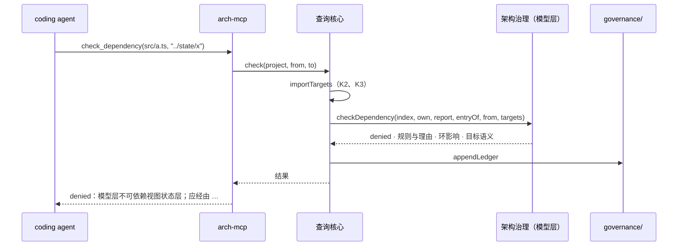

# 专题：架构治理

> 回答：代码依赖从哪里来；描述的关系对不对；架构规则怎么判、门禁怎么卡；agent 怎么在写代码前询问。
> 覆盖模块：接入层的「依赖提取」「治理存储」「agent 接口」；模型层的「架构治理」「返工清单」「确认」。规则见 [02-domain.md](../02-domain.md) 的 K、U、Y、Q（返工清单 Q7–Q9）、Z（人确认层）；决策见 [ADR-0015](../adr/0015-architecture-governance.md)、[ADR-0023](../adr/0023-sketch-reviewed-and-evolution.md)；界面见[工作台界面](./workbench.md)；归属与入口复用[源码接入与归属](./source.md)。

## 1. 分工

```text
本地源码根目录                         接入层：只读语法，不判断归属与规则
   │ readCodeDeps（K1–K3，按修改时间缓存）
   ▼
CodeDeps { deps: FileDep[], external, parsed }   +  governance/baseline.json · ledger.jsonl（治理存储）
   │  开发服务器端点 source/<项目>/facts.json；命令行与 agent 接口直接调用
   ▼
governanceReport(index, own, tree, deps, baseline)      模型层：纯函数
   ├ liftDeps → ModuleDep（K4）
   ├ confirmRelations · undescribedDeps（K5–K7）
   ├ evaluateRules → Violation（U2–U6）
   ├ cycles · cyclicity（Y1–Y3）
   └ gate → Issue（U8）
   │
   ├─ DeskState：levelFacts（K9、Y4、Y5）→ 画布叠加与面板
   ├─ lint:model：问题与摘要
   └─ agent 接口：locate · describeModule · checkDependency · summarizeLedger（Q1–Q4）
```

- 「这条依赖违不违规」「这条关系是真是假」是关于被描述系统的知识，换成命令行、MCP 同样需要，所以全部在模型层（原则 6）；页面、`lint:model`、agent 接口三处结果一致（Q6）。
- 接入层只做两件事：读懂 TypeScript 的导入语法，以及读写 `governance/` 下的两个文件。
- git 历史（修改热度、缺陷热度、时间耦合）是与代码事实并列的第三类事实，见[演化事实](./evolution.md)（ADR-0023）；返工清单多一类「时间耦合」（J6）。

## 2. 依赖提取（接入层，`vite/readDeps.ts`）

| 函数 | 做什么 | 规则 |
|---|---|---|
| `readCodeDeps(root, files, packages)` | 对清单中的脚本文件逐个解析（Vue 取 `<script>` 块），收集导入语句；说明符解析与再导出穿透见下；按绝对路径的修改时间与大小缓存每个文件的解析结果 | K1–K3 |
| `readPathAliases(root, files)` · `createResolver(root, files, packages)` | 读出清单中各 `tsconfig*.json` 的 `paths`，交给模型层的 `specResolver`（[source.md §3](source.md)）解析；解析不到返回 `null`（外部依赖） | K2 |
| `importTargetKinds(imp, via, exportsOf)` · `importTargets(via, names, exportsOf)` · `resolveImport(…, from, spec, names?)` | 一条导入的目标与种类：命名导入沿再导出链追到声明文件（复用导出解析的 `exportsResolver`，带本次的说明符解析，裸说明符与先导入再本地导出也追，最多 5 层），每个名字按写法（`type X`）或声明（`interface` / `type`）判为类型，只承接类型名的目标为 `type`；其余以经由文件为目标、取整条语句的种类；每个目标另记落到它的导入名 `names`、是否被类的 implements / extends 引用 `heritage`、是否引用了实现 `uses`（值导入的名字声明为函数、类或变量，且在值位置被引用：解析导入时 `parseImports` 记下没有在值位置出现的导入名 `inert`——只在类型位置、`instanceof` 右侧或只本地再导出 `export { x }` / `export default x`；Vue 模板里出现的名字算引用；`export … from` 记 `reexport`，都不记 `uses`）、其中是否有交互使用 `invokes`（`parseImports` 记下被引用却从没被调用的名字 `reads` 与引用方式——`member` 只作成员读取的基、`bare` 其余；成员读取为纯值读取，`bare` 的名字声明为函数、类、默认导出或 `callable` 的变量时算交互，常量不算；调用、`new`、`extends`、成员调用、模板标签与模板里的调用都是交互）（写进文件依赖，`uses` 供 K5 的 implements 证据与 U11、U12，`invokes` 供 K7）；`importTargets` 只取目标，`resolveImport` 供写前判定按说明符解析 | K1a、K3 |

- 路径补全与包入口只有一套，在模型层（`completePath`、`packageEntry`，K2）：入口文件（G10）、导出解析（G11）与这里共用，模块入口与依赖的经由文件口径一致。
- 一个文件的解析结果：`{ line, spec, kind, names, types, heritage }[]`（`types` 为写成只引类型的名字，`heritage` 为本文件类声明的 `implements` / `extends` 引用到的导入名，ADR-0022），与文件内容一起缓存；目标解析每次按当前清单做（清单变了结果跟着变）。
- 性能（实测）：h5player 1657 个脚本文件首次提取 1.7 秒、缓存命中 0.2 秒；本项目约 170 个文件 0.16 秒。之后只重解析变化的文件。

> 第六轮（ADR-0029、ADR-0030，已实现）：解析结果另记 `inherits`（导入名、子句 `implements` / `extends`，目标上带穿透后的声明种类），供 K5c 与子类事实（K12）；交互使用另记 `invokeKinds`（`call` / `extends` / `new` / `factory` / `register`，命名见 T0 裁决 6），K7 只看 `call`，K13 看后三种。

## 3. 治理存储（接入层，`vite/governanceStore.ts`）

| 函数 | 做什么 | 规则 |
|---|---|---|
| `governanceDir(modelRoot, project)` | `model/<项目>/governance/` | — |
| `readBaseline(dir)` / `writeBaseline(dir, baseline)` | 读写 `baseline.json`（格式化 JSON，键排序，便于评审差异） | U7 |
| `readLedger(dir, limit?)` / `appendLedger(dir, entry)` | 读（最近 N 行）/ 追加 `ledger.jsonl`，一行一个 JSON；三种行：`check_dependency`、`rescan`（agent 接口）、`reviewed`（确认记录写入，`appendReviewed` 写，Z6） | Q4、Z6 |
| `sourceCommit(root)` | 源码根目录的 `git rev-parse HEAD`，失败为 `undefined` | U7 |
| `readOwned(dir)` / `writeOwned(dir, record)` | 读写 `owned.json`：`{ updatedAt, files: { 路径: SHA-1 } }`，键排序 | X6 |
| `ownedHashes(projectDir)` | 列出项目下人拥有的文件（`isOwnedFile`）并算指纹，交给模型层 `compareOwned` | X6 |
| `registerOwned(modelRoot, project)` | 命令行 `arch own`：把全部人拥有文件的指纹写进 `owned.json`（只由人执行） | X6 |
| `touchOwned(modelRoot, project, file)` | 写入端点写完一个人拥有的文件后更新它的指纹（没有 `owned.json` 时新建，只含这一项） | X6 |

- `readModelDir` 跳过项目下的 `governance/`（与 `designs/` 同），它不属于描述。

## 4. 架构治理（模型层，`src/model/governance/`）

| 函数 | 做什么 | 规则 |
|---|---|---|
| `liftDeps(index, own, deps)` | 文件依赖两端取归属模块，去掉同模块与祖先后代，按 `A->B` 合并为 `ModuleDep`；一端未归属或已忽略的计入 `skipped`，一端是归属冲突文件的不提升、列入 `conflicted`；另记祖先与后代之间的模块对 `nested`（K6 判定两端有无依赖用）；返回 `{ moduleDeps, skipped, conflicted, nested }` | K4 |
| `hostOf(index, direct, id)` · `confirmRelations(index, moduleDeps, direct)` | 宿主：自身或最近的、有直接归属文件的祖先。每条关系：端点有参与者或目标态 → `skipped`；写了 `via` → `skipped` 并带 `via`（K5b，面板标「不判定：经 …」）；两端宿主相同 → `skipped` 并带 `host`（概念拆分，同文件，面板说明）；有 `from` 子树 → `to` 子树的模块依赖（`notifies`、`streams` 两向；`implements` 还要求依据的文件依赖中有 `to` 声明的接口名或类的 implements / extends 指向 `to`，没有时 `unconfirmed`，只引了数据类型带 `structural`、引用了实现（文件依赖的 `uses`）带 `likeDepends`）→ `confirmed`，带依据的模块依赖键与知识方向 `knows`；否则 `unconfirmed`，两端之间（模块依赖与 K4 未提升的祖先后代依赖 `nested`，不论方向）没有任何依赖时带 `isolated`。`unconfirmedWarns(r, c)`：编译期关系未证实、或运行时关系 `isolated` 时报 `fact.unconfirmed`（`likeDepends` 时报 `fact.like-depends`）；`unconfirmedReason(r)` 给问题、返工项共用的说明 | K5、K5a、K6 |
| `undescribedDeps(index, moduleDeps)` | 未解释的交互：有交互使用（文件依赖的 `invokes`）、且没有交互关系（`calls` / `notifies` / `streams` / `implements`）覆盖的模块依赖（端点相同或互为祖先后代、方向一致，`notifies`、`streams` 不论方向）；只引类型（含枚举）的、纯值读取（只有 `uses` 没有 `invokes`）的不算；info（ADR-0026，纯值读取口径：第五轮 T4） | K7 |
| `portTriad(index, report, moduleId)` | 端口三角：定义（`moduleInterfaces`）· 实现者（`to` 在子树内的 `implements`）· 使用者（`to` 在子树内的 `calls` / `streams`，含 `via`；ADR-0026 去掉 `depends`）；给了证实结果时每项带状态 | K11 |
| `judge(index, rules, entryOf, dep)` | 一条（依赖方模块，被依赖方模块，经由文件及其归属）对全部规则的判定：层规则、白名单、访问面，返回命中的 `{ kind, at, reason }` 与是否有规则约束；`allow` 匹配的标为已豁免 | U2–U5 |
| `evaluateRules(index, own, moduleDeps, entryOf)` | 对每条模块依赖的每条文件证据 `judge`，按 `<种类>:<规则所在>:<A>-><B>` 合并为 `Violation` | U6 |
| `stronglyConnected(edges)` · `valueDeps(moduleDeps)` · `moduleCycles` · `fileCycles` | Tarjan 强连通分量，返回规模 ≥ 2 的分量，成员按名称排序；环只按值依赖：`valueDeps` 只留含 `value` 文件依赖的模块依赖（证据也只留 `value`），文件环只取 `value` 文件依赖——模块环、文件环、本层环（Y4、Y5）与写前判定的环影响（Q2）同一口径 | Y1 |
| `cyclicity(cycles)` | 未容忍的环的 Σ 规模² | Y2、Y3 |
| `governanceReport(index, own, tree, deps, baseline)` | 组合以上：事实、比对、违规（带基线状态）、模块环与文件环、环度、门禁问题与摘要 | K4–K7、U8、Y |
| `levelFacts(index, view, report)` | 当前层次：视图边的证实标记与违规；未解释的交互与违规投影成的叠加线；本层的环编号；每个本层环的构成（环内节点按视图顺序，环内每条本层依赖带同方向视图边与投影来的模块依赖，均只取值依赖 `valueDeps`）——与环编号同一次投影得出，不另取事实 | K9、Y4、Y5 |
| `depsBetween(index, view, report, from, to)` | 叠加线选中时的内容：投影到这对节点的模块依赖、违规与文件证据 | K10 |
| `rulesFor(index, moduleId)` | 对一个模块生效的规则：所在各级层的 `mayDependOn`、祖先链上的白名单与访问面 | Q1 |
| `describeModule(index, own, report, entryOf, id)` · `locate(…, file)` | agent 用的模块 / 文件说明：路径与各级职责、生效的规则、接口签名、入口、出入关系与违规 | Q1 |
| `checkDependency(index, own, report, entryOf, from, targets)` | 写前判定：对每个目标 `judge`，取最严；环影响为在值依赖的模块图（`valueDeps`）上加边后重算包含两端的强连通分量；附覆盖关系与目标模块语义 | Q2 |
| `stepEvidence(frame, index, own, deps, entryOf)` · `scenarioEvidence(plan, …)` | 步骤的候选调用点与证据等级（按名字匹配 / 按模块依赖 / 无证据 / 不判定）、场景各等级计数；算法见[场景投影与回放 §10](./scenario.md#10-步骤的代码证据) | S16 |
| `summarizeLedger(entries)` | 按判定统计次数；扫描的违规数与环度首末值 | Q4 |
| `classifyRelation(index, report, relation, code?)` · `classifyRelations(…)`（`classify.ts`） | 查询 / 委托的分类建议（ADR-0029 §5「分类是主张」）：按第一问「被调方拥有后果吗」打分，证据为代码事实（交互种类、调用点的结果是否被使用、被调函数签名的返回形态、目标文件的状态持有，`code` 由接入层 `readClassifyCode` 提取）、描述（目标是共用件、目标会发出通知、接口签名、目标模块名）与名字（被调函数名、成员名、说明里的动词）；输出建议类型、置信度（高 / 中 / 低）、依据，只有继承或只有组装的标 `factOnly`；平分或没有证据时按委托、低置信度。`interactionDescription` 把说明改为交互口吻（查询「A 向 B 取：…」，委托「A 交给 B：…」） | M17 |

> 第六轮（ADR-0029、ADR-0030）：已实现——`confirmRelations` 按四类交互判定（迁移期未分类同原 `calls`），`via` 按四形态（K5b，经端口的证实带 `port`）；`confirmImplementers`（端口实现者三档与「仅代码事实」的实现者，K5c，结果在报告的 `implementers`）、`heritageFacts`（子类事实，K12，报告的 `subclasses`）、`assemblyFacts`（组装事实与组装根，K13，报告的 `assembly` / `assemblyRoots`）、`portEntry` / `portPanel`（K11）与 `portIssues`（U14）都在 `facts.ts`；`undescribedDeps` 加三种覆盖（K7）；描述查询 `unclassifiedRelations` / `isCoreBetween`（M17）。`portTriad`（`ports.ts`）保留为迁移期兼容。待实现：`levelFacts` 的组装叠加线（O12，T3）。

### 4.1 数据结构

```ts
interface FileDep { from: string; to: string; via: string; kind: 'value' | 'type'; line: number }
interface CodeDeps { deps: FileDep[]; external: Record<string, number>; parsed: number }
interface ModuleDep { key: string; from: string; to: string; files: FileDep[] }      // key = `${from}->${to}`
type RuleKind = 'layer' | 'deps' | 'exposes'
interface Violation {
  key: string; kind: RuleKind; at: string; from: string; to: string; reason: string
  files: FileDep[]; status: 'new' | 'known' | 'open' | 'allowed'; allowReason?: string
}
interface Cycle { members: string[]; tolerated: boolean }
interface Baseline { createdAt: string; commit?: string; violations: string[]; cyclicity: { modules: number; files: number } }
interface GovernanceReport {
  moduleDeps: Map<string, ModuleDep>; skipped: number; conflicted: FileDep[]; external: Record<string, number>
  relations: Map<string, { status: 'confirmed' | 'unconfirmed' | 'skipped'; deps: string[]; host?: string; isolated?: boolean }>
  undescribed: ModuleDep[]; violations: Violation[]
  moduleCycles: Cycle[]; fileCycles: Cycle[]; cyclicity: { modules: number; files: number }
  baseline: Baseline | null
  gate: { newViolations: number; knownViolations: number; resolved: number; cycleGrew: boolean }
  issues: Issue[]
}
type Verdict = 'allowed' | 'denied' | 'unconstrained'
// Y5：本层环的构成（契约类型，呈现层直接引用）
interface LevelCycleEdge { from: string; to: string; fromModule: string; toModule: string; edgeId?: string; deps: ModuleDep[] }
interface LevelCycle { id: number; nodes: { id: string; module: string }[]; edges: LevelCycleEdge[] }
// levelFacts 的结果：{ edgeFacts, violatedEdges, overlays, cycles: Map<节点, 环编号>, levelCycles: LevelCycle[] }
```

### 4.2 返工清单（模型层，`src/model/rework/`）

工具擅长发现问题，返工清单让问题带着「在哪、为什么、怎么改」离开工具：页面问题页签、命令行与 MCP 用同一份结果。

| 函数 | 做什么 | 规则 |
|---|---|---|
| `reworkList({ index, issues, source?, report?, evolution?, sketches?, deps? })` | 汇总：校验问题（跳过归属、证据、门禁、事实与 S5a 未建模，它们由下列材料重新算；`owned.*` 归入类别 `owned`）、归属（冲突按匹配的 codeRefs 组合，`detail` 注明一端是这组文件、因冲突未计入的依赖条数（`report.conflicted`，K4）；未归属按目录；entry 不存在）、不在清单里的场景证据文件（`missingEvidence`，归描述问题，S15）、违规（按基线状态 · 种类 · 规则所在 · 被依赖方）、环度上升与可收紧基线、报警的未证实关系（`unconfirmedWarns`）、未解释的交互、未建模的步骤（`bindRelation` 绑定不到关系的消息步骤，按两端聚合）、无证据的步骤（给了文件依赖 `deps` 时，`scenarioEvidence` 为 `none` 的步骤按两端与方向聚合，S17）、草图偏差（`sketches`：每张活动草图的 `SketchCheck`，一条偏差一个根因，已认可的不进清单，X4）；排序后给出各严重度与类别的计数 | Q7、Q8 |
| `reworkMarkdown(list, title, { modelDir, sourceRoot, limit })` · `reworkItemMarkdown(item, opts)` | 给 agent 的指令：摘要、每条的规则、位置、受影响（缺省最多 20 处）、建议与 YAML 片段；描述文件路径加模型目录前缀 | Q9 |

```ts
type ReworkCategory = 'description' | 'violation' | 'shared' | 'cycle' | 'ownership' | 'unconfirmed' | 'undescribed' | 'unmodeled' | 'review' | 'coupling' | 'sketch' | 'owned' | 'unevidenced'   // shared：共用件反向依赖（U12）；review：需复核（Z3）；coupling：时间耦合（J6）；sketch：草图偏差（X4）；owned：指纹不符（X6）；unevidenced：步骤无证据（S17）
interface ReworkLoc { in: 'description' | 'source'; file: string; line?: number; note?: string }
interface ReworkAction { kind: ReworkActionKind; text: string; file?: string; snippet?: string }
interface ReworkItem {
  id: string /* `<类别>:<根因键>`，稳定 */; category: ReworkCategory; severity: 'error' | 'warning' | 'info'
  rules: string[]; code: string; title: string; detail?: string; status?: ViolationStatus
  at?: ReworkLoc /* 根因所在 */; affected: ReworkLoc[]; actions: ReworkAction[]
  target: { modules?: string[]; relation?: string; dep?: string; file?: string; scenario?: string } // 页面定位
}
interface ReworkList { items: ReworkItem[]; counts: Record<Severity, number>; byCategory: Record<ReworkCategory, number>; facts: boolean }
```

- 聚合的判据是「改一处能消掉几条」：同一组重叠的 codeRefs、同一目录的漏写、越过同一条边界依赖同一个模块（常见于契约放错了层）、同一对端点之间缺的关系。h5player 的 178 条违规由此收成 13 条。
- 建议动作只给方向与片段，不替人决定：加例外、收紧基线、认可偏差、登记指纹由架构师决定（U5、U7、X4、X6）。

> 第六轮（ADR-0029，待实现）：`ReworkCategory` 加 `unclassified`（核心之间的未分类，M17）、`query-side-effect`（U13）、`port`（U14）；「证据像使用」的建议改为「从 `implementedBy` 去掉并按交互改写」（Q8）。

### 4.3 确认（模型层，`src/model/review/`）

人确认层（Z1–Z6，ADR-0023）：架构师看过并认可了什么。记录在人拥有的 `reviewed.yaml`（写法见 [04 §3.9](../04-description-format.md)），指纹与状态判定是纯函数，页面、命令行与草图归档同一份。

| 函数 | 做什么 | 规则 |
|---|---|---|
| `reviewSummary(index, moduleId)` | 架构师应当理解的部分：`responsibility`（去首尾空白）、`includes` / `excludes`（声明顺序）、`mayDependOn`（排序）、`provides`（按 ID 排序的 `{ id, signature }`，接口不存在时 `signature` 为空）、`children`（直接子模块 ID，排序） | Z2 |
| `reviewHash(index, moduleId)` · `summaryHash(summary)` | 摘要规范化拼接后的 64 位哈希（两段 32 位 cyrb 混合，16 位十六进制）；内容相同必得相同指纹 | Z2 |
| `reviewStatus(index, entry, moduleId)` → `'reviewed' \| 'stale' \| 'unreviewed'` | 有记录且指纹一致 / 有记录、指纹不一致 / 没有记录 | Z3 |
| `reviewDiff(before, now)` | 两份摘要的差异：职责按行增删、`includes` / `excludes` / `mayDependOn` 按项增删、接口按 ID 增 / 删 / 改（带前后签名）、子模块按 ID 增删 | Z3 |
| `reviewScope(index)` | 默认提供确认的模块：核心模块（任意层次的 `role: core`，ADR-0027）与第二级模块（根的子模块的子模块） | Z4 |
| `sharedSuggestions(index, moduleDeps)`（`governance/roles.ts`） | 疑似共用件：没有 `role`（自身与祖先都不是共用件）的非层模块，入度来自 ≥2 层或 ≥3 兄弟（只算值使用）、子树没有指向外部的运行时关系、子树不在任何场景帧上（`scenariosOf`）、`kind: library` 或 ID / 名称含 shared / util / labels / contracts，每个带四条依据；`sharedReverse(index, moduleDeps)`：共用件子树对子树外、不在任何共用件子树内的模块的值依赖；两者都进治理报告（`sharedSuggestions`、`sharedReverse`），反向依赖另报 warning `role.shared-reverse`（ADR-0027） | U11、U12 |
| `reviewStates(index)` | 每个模块的 `{ status, entry?, diff? }`；记录来自 `index.model.reviewed`（Validator 已去掉引用不存在模块的记录并按模块去重，Z1） | Z1、Z3 |
| `reviewCounts(index)` | 范围内的 `{ scope, reviewed, stale }`，根层健康度与项目卡片同一口径 | Z5 |
| `reviewEntries(index, ids, { source, note?, at? })` | 为一组模块生成当天的确认记录（hash、summary），页面「确认」与草图归档都用它构造写入 | Z4、Z6 |

- 返工清单（§4.2）多一类 `review`（「需复核」）：一个需复核的模块一条，warning，规则 Z3，`detail` 为差异摘要，建议动作 `{ kind: 'review', text: '在面板上复核并确认' }`——人的动作，没有 `snippet`。`lint:model` 不列它，只在摘要给出「确认：已确认 a / b · 需复核 c」。
- `projectHealth` 另给 `reviewed: { scope, reviewed, stale }`（Z5），它只读描述，读不到代码事实时也有；有共用件时给 `shared`（Q13，`sharedHealth(index, own, report, lines?, history?)`：共用件个数、反向依赖条数、行数占比（G19，阈值 `sourceLimits.sharedRatio`，缺省 0.2）、近窗口修改占比（J2 口径，阈值 0.3）与是否超阈值）；开发服务器的 `readHealth` 在有共用件时读 git 历史（按 HEAD 缓存），根层面板在演化事实加载后才有修改占比。
- 写入：`POST write/<项目>/reviewed`（[加载与版本 §2.2](./loading-and-versions.md#22-写入人拥有的文件vitewritemodelts-b1b5-adr-0019)）与 `appendReviewed(modelRoot, project, entries, root?, { origin?, design? })`：逐条按 `module` 更新已有记录或追加；每条 `hash` 必须等于当前 `reviewHash`，不符整次拒绝；写后在 `ledger.jsonl` 追加 `{ at, tool: 'reviewed', origin, modules, design? }`（`origin`：端点为 `page`、归档为 `archive`、其余 Node 侧调用缺省 `cli`，Z6）；`entries` 的字段 `module`、`at`、`hash`、`summary`、`source`、`note?`；草图归档（X 组）调用同一个函数一次写多条。

### 4.4 意图（模型层，`src/model/intent/`）

草图是架构师的意图（02 §1.10）；核验回答「版本有没有按意图来」，与「这条依赖违不违规」一样是关于被描述系统的知识，页面、`lint:model` 与 agent 接口同一份结果。

| 函数 | 做什么 | 规则 |
|---|---|---|
| `isSketchFile(path)` · `isOwnedFile(path)` | 契约小谓词：`intent/*.yaml` 与 `designs/<设计>/sketches/*.yaml` 是草图文件；人拥有的文件清单（草图、`rules.yaml`、`source-ignore.yaml`、`designs/*/design.yaml`、`reviewed.yaml`） | X1、X6 |
| `flattenSketch(def)` | 草图定义展开为实体清单：模块（带父 ID：嵌套位置、`parent`，否则根）、关系、接口、数据结构，每条记住写了哪些字段 | X2 |
| `sketchCheck(sketch, index, { persistent?, accepted?, design?, baseline? })` | 核验（相对当前版本，v2 口径见下文）：先查与持久草图的矛盾（同挂载点、未声明 `supersedes` → `sketch.contradiction`）；再逐项比对版本——缺模块 `sketch.missing-module`、封闭子树多出的直接子模块 `sketch.extra-child`、字段不一致 `sketch.field`（error）；关系没有对应 `sketch.missing-relation`（两端 + 类型，版本里两端落在草图两端子树内也算）、接口不存在 / `owner` 不同 `sketch.missing-interface` / `sketch.interface-owner`（warning）。每条偏差带稳定键 `<种类>:<实体 ID>`、所在实体与建议；`accepted` 里的 warning 降为 info 并带理由；结果 `SketchCheck { sketch, deviations, counts, consistent }`，`consistent` = 零 error 且提醒都已认可 | X2、X4 |
| `parseDesignSketches(files)` · `checkSketches(index, designSketches, accepted?)` | 载荷附带的设计草图解析为草图实体（记所属设计）；对一个版本有约束力的草图逐张核验：版本自带的持久草图（`index.model.sketches` 里 `lifetime` 为 `persistent` 的）+ 载荷附带的设计草图，持久草图另作矛盾检查的依据；返回每张的 `SketchCheck`，`accepted` 按设计给出 | X3、X4 |
| `archiveVerdict(check)` | 归档判定（输入为 `checkSketches` 给出的那张设计草图的核验结果）：核验一致才能归档；结局按 `supersedes` 为「晋升」、否则「归档」；持久草图不能归档 | X3 |
| `sketchModules(sketch, index)` | 归档时写确认记录的对象：草图覆盖的、版本里存在的模块；记录本身（指纹、摘要）由确认层的 `reviewEntries` 按它的口径生成，经 `appendReviewed` 写入（`archiveDesign` 直接调用） | X3 |
| `compareOwned(record, hashes)` | 指纹比对：已登记的文件内容不符或已不存在 → error `owned.changed`；人拥有的文件未登记 → warning `owned.unregistered`；没有记录 → warning `owned.none` | X6 |

意图分三个子模块（ADR-0024、ADR-0025）：**核验与生命周期**（`check.ts` · `lifecycle.ts` · `owned.ts` · `lineage.ts` · `scope.ts`，即上表与下表的对比；矛盾检查另以 `sketchContradictions(sketch, persistent)` 导出，只比同挂载点，供草图校验共用）、**草图编辑**与**草图校验**（下表，格式 v2 已实现）。

| 函数 | 做什么 | 规则 |
|---|---|---|
| `applyEdit(sketch, op, ctx)`（`edit/apply.ts`） | 单张草图的纯函数编辑：输入草图定义、一个编辑操作 `EditOp`（层；模块；移动与改 ID；关系与接口；元信息；ADR-0025 起加挂载点原则 `setAbstraction`、位置 `moveNode` / `relabel` / `autoArrange`、引用 `addReference`）与上下文（持久草图、范围外可引用的模块 `known`），输出新草图与影响 `{ created, renamed, removed }`，或拒绝原因；按操作族分 `locate` · `layers` · `modules` · `move` · `relations` · `layout` · `seed` | X7b–X7e、X15、X19 |
| `applyDesignEdit(sketches, op, ctx)`（`edit/design.ts`） | 设计级编辑：输入输出为一个设计的全部草图（按挂载点）；`DesignEditOp` 为单张操作（`edit`）或跨草图的**合并 / 拆分 / 降级 / 升级 / 移入 / 改 ID / 删除**；ID 变了一律前缀级联（子草图改挂载点与模块 ID，被改写的记 `from`，关系两端、接口 `owner`、`closed`、`layout` 的键随之改写），`from` 沿血缘求闭包；影响另列涉及的草图、改挂载点的草图、删掉与新出现的草图 | X7b、X7d、X7e、X7j、X7k、X11、X12 |
| `seedFromBaseline(mount, baseline, { id })` · `deriveChildSketch(mount, baseline, sketches, { id })`（`edit/seed.ts`） | 底稿从基线复制挂载点的一层（结构字段与显式写在本层的关系，不带文字；根挂载 `supersedes` 骨架）；下一层草图不存在时由「基线子树 + 血缘」推出 | X18 |
| `gridLayout` · `referenceNodes` · `layoutForSave`（`edit/layout.ts`） | 网格布局（重新排列，按中心区可用区域）；引用节点由关系派生；保存前去掉引用节点的位置、丢掉没有关系的引用 | X15、X19、X22 |
| `idImpact(sketch, id, newParent, current?)` | 移动前的影响：草图内改写的 ID 与引用条数、当前版本里仍引用旧 ID 的实体条数 | X7d |
| `validateSketch(sketch, { persistent, file, index?, design? })`（`validate.ts`） | 两级：`errors`（schema、ID、不在挂载点下、挂载点是层、文件名与 `mount` 不一致、引用不存在、缺名称、关系不在本层，拦保存）与 `warnings`（根草图层依赖成环、同挂载点矛盾、待重连，拦交给 AI 与定稿）；`hints`（超七、没写职责）不进两级；另给 `pending`（待重连的关系） | X7f、X9、X13、X14、X16 |
| `compareSketch(sketch, target, { mode, lineage? })` · `compareDesign(sketches, target, mode)` · `changeSummary`（`check.ts`） | 两个对比共用：按挂载点取对象版本的同一范围（`mountScope`，`scope.ts`），按血缘（`lineage.ts`：`sketchLineage`、`prefixMap`、`lineageKind`）读作新增 / 修改 / 合并 / 拆分 / 改 ID / 移动 / 删除；`baseline` 比结构与写了的文字，`current` 只比结构；全设计 = 各张并集，血缘按全设计算；摘要措辞「合并 A、B 为 N」 | X11、X12、X17 |

`sketchCheck` 的 v2 口径：按挂载点取范围（封闭与「多出」只看挂载点与本层模块的直接子模块，本层模块的看挂在它上的草图），矛盾只比同挂载点（X10），缺模块的措辞按血缘，另报血缘的来源仍在原处（`sketch.not-applied`）与给了基线时「草图删掉、版本里还在」（`sketch.not-removed`）；`checkSketches` 按设计分组传全设计的血缘与可选的基线。`diffModels(base, target, { lineage })` 给了血缘时变更条目带 `kind: merged / split / renamed / moved` 与 `from` / `to`，被吸收的来源、级联改名的后代与只因血缘改了端点的关系不另列。

```ts
interface SketchDeviation {
  key: string                           // `<种类>:<实体 ID>`，稳定
  code: 'sketch.contradiction' | 'sketch.missing-module' | 'sketch.extra-child' | 'sketch.field' | 'sketch.missing-relation' | 'sketch.missing-interface' | 'sketch.interface-owner'
  severity: 'error' | 'warning' | 'info'; rules: string[]
  message: string; detail?: string
  target: { modules?: string[]; relation?: string; interface?: string }
  at?: SourceLoc                        // 草图里的位置
  accepted?: { reason: string; at?: string }
}
interface SketchCheck { sketch: string; design?: string; deviations: SketchDeviation[]; counts: { error: number; warning: number; info: number }; consistent: boolean }
```

> 第六轮（ADR-0029，待实现）：`sketchCheck` 按 X23 比关系类型（未分类与查询 / 委托视为对应）、按 X24 核验草图声明的端口实现者（`sketch.missing-implementer`），相对当前版本的结构对比加入 `via` 与 `implementedBy`（X17）。

## 5. agent 接口（接入层，`scripts/agent/`、`scripts/arch.ts`、`scripts/arch-mcp.ts`）

查询核心 `createService({ modelRoot, root })`：按项目加载描述、源码清单、依赖、基线，算出 `GovernanceReport` 并缓存。每次查询前重新列出源码清单，比对输入的指纹（描述文本、清单与其中每个文件的修改时间与大小、基线文件的修改时间），有变化就重建（依赖提取按文件缓存，只重解析变了的文件），所以 MCP 长驻时新建文件、新加依赖后无需 `rescan` 即可 `locate`、`check`。`rescan` 总是重建，并与本会话上一次扫描（还没扫描过时为首次加载的结果）、与基线比较。两种外壳只做参数解析与输出格式。

| 命令行 `npm run arch -- …` | MCP 工具 | 说明 | 写拦截记录 |
|---|---|---|---|
| `projects` | `list_projects` | 项目与源码状态 | — |
| `locate <文件或模块>` | `locate` | Q1 | — |
| `check <from> <to>` | `check_dependency` | Q2；`to` 可为导入说明符 | ✅ |
| `violations [--new]` | `list_violations` | 违规与基线状态 | — |
| `cycles` | `list_cycles` | 模块环、文件环、环度与基线 | — |
| `rescan` | `rescan` | Q3 | ✅ |
| `issues [--category <类别>]` | `issues`（`format`、`category`） | 返工清单（Q7–Q9），命令行缺省 Markdown、`--json` 为 JSON | — |
| `report` | `prevention_report` | Q4 | — |
| `baseline` | —（Q5） | 生成基线，由人执行 | — |
| `own` | —（X6） | 登记人拥有文件的指纹 `governance/owned.json`，由人执行 | — |
| `sketch-check [--design <设计>] [--revision <轮次>]` | `sketch_check` | X4：活动草图对当前版本（缺省）或设计某一轮的核验，命令行缺省给人看的文本、`--json` 为结构化结果 | — |
| `sketch archive <设计>` | `sketch_archive` | X3、X8：归档 / 晋升，与页面同一函数 `archiveDesign`；不一致即拒绝 | — |
| `classify [--design <设计> [--revision <轮次>] \| --all-designs] [--core-only] [--override <文件>] [--write]` | — | 未分类关系的查询 / 委托建议（`classifyRelation`）：关系、两端、建议类型、置信度与依据；设计各轮没有代码事实，同 ID 的关系沿用当前版本的分类；`--override` 为人工核对后的覆盖（关系 ID → 类型）；`--write` 只改描述文件里 `type` 与 `description` 两个值（没有说明的补一个），草图（人拥有）只改 `type`，草图写了说明的关系各处都不改说明 | — |

- 查询核心加载时一并比对指纹（`compareOwned`），`owned.*` 问题进 `issues`。

- 每个工具都有可选参数 `project`（Q6）。命令行默认输出给人看的文本，`--json` 输出与 MCP 相同的 JSON。
- MCP 服务器经 stdio 通信，stdout 只留给协议；日志写 stderr。
- 接入：在 agent 的 MCP 配置里加入 `npm --prefix <本包路径> run -s arch:mcp`；本包根目录的 `.mcp.json` 是示例（在本仓库里自举）。

## 6. 运行时序



## 7. 页面

- `source/<项目>/facts.json`：`{ deps, baseline, ledger }`（拦截记录取最近 2000 行）；源码清单读取失败时 404，事实状态为 `error` 并带原因（K8、G1）。
- DeskState 的 `facts` 分组：源码清单就绪后取事实；`report = governanceReport(…)`；`level = levelFacts(…)`（只在结构视角、「代码事实」开启时用于画布，开关缺省开启；违规只取基线外的，K9）；`selectedCycle`：选中的模块（本层节点或边界节点）所在的本层环（Y5）；返工清单（`desk.rework`，与描述、归属一起汇总）进问题页签（U9、W-6）。「刷新源码」同时重新取事实。
- 画布：`canvasScene` 多两个输入——视图边的证实与违规标记、叠加线（坐标由 `linkRoute` 算，不参与布局）；节点数据多 `cycle` 编号（K9、Y4）。
- 选中 `{ kind: 'dep', id: '<A>-><B>' }`：URL `sel=d:`，面板 `DepPanel`（K10）；运行视角下按选中关系的方式突出两端泳道。
- 本层环可解释（Y5）：模块面板「架构治理」一节列出 `selectedCycle`，单击一条本层依赖即 `select`——有 `edgeId` 时选中视图边（`sel=e:`），否则选中代码依赖（`sel=d:`），画布按已有的选中规则高亮视图边或叠加线。
- 人确认层（Z）：DeskState 的 `review` 分组——`states`（每个模块的状态与差异，`reviewStates`）、`counts`（Z5）、`scope`（Z4）、`canReview`（只对当前版本）；写入意图 `review.confirm(ids, note?)` 经 `ModelWriter.reviewed` 发 `POST write/<项目>/reviewed`，结果由文件变化推送回来（N5）。模块面板（`ReviewSection.vue`）：标题旁状态标记、需复核时「自上次确认以来的改动」、底部「确认 / 复核并确认」与「也确认子模块」；模块树需复核标记与「只看需复核」；根层健康度与项目卡片「核心模块已确认 a / b · 需复核 c」；返工清单「需复核」项。
- 意图（X3、X4）：DeskState 的 `intent` 组——活动草图、每张的 `sketchCheck`、归档判定；系统面板「意图」一节（`IntentSection.vue`）列每张活动草图的偏差计数与「查看偏差」（切到问题页签）；设计面板的「草图核验」（偏差清单、提醒级偏差的「认可偏差（写理由）」→ `desk.write.accept`、一致时的「归档」/「晋升」→ `desk.write.archive`）；草图版本的设计信息条「交给 AI」。
