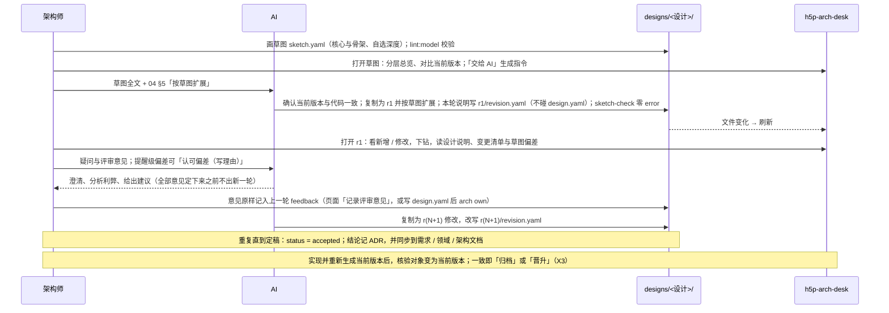

# 专题：描述加载与版本

> 回答：描述文件怎么从磁盘变成可查询的模型；设计版本怎么读、怎么与基线对比。
> 覆盖模块：接入层（ModelSource 插件、描述读取、命令行校验）；模型层的类型与 Schema、加载流水线、版本对比。总览见 [03-architecture.md](../03-architecture.md)，规则见 [02-domain.md](../02-domain.md)（M、E、S5–S13），文件写法见 [04-description-format.md](../04-description-format.md)。

## 1. 分工

```text
磁盘 model/<项目>/…            接入层只搬运原文，不解释含义
   │ readProject / readDesignRevision
   ▼
ModelPayload { files: RawFile[], designs, commits, version?, compare? }
   │ （页面与命令行各自调用，保证两边报错一致）
   ▼
loadModel(files) = load → validate → buildIndex      模型层
   ▼
ModelIndex + Issue[]      ──diffModels(基线, 设计或提交)──▶ ModelDiff（设计版本与提交版本）
```

## 2. 读取（接入层）

| 函数 | 做什么 |
|---|---|
| `resolveModelRoot` | 模型根目录：`ARCH_MODEL_ROOT`，缺省为项目内 `model/`（ADR-0001） |
| `listProjectIds` | 根目录下含 `system.yaml` 的子目录即项目；ID 只允许目录名安全字符，防路径穿越 |
| `readProject` | 读项目当前版本的全部描述文件（含 `intent/` 的持久草图），**跳过 `designs/`**；附带该项目的设计版本列表，以及已定稿、未归档的设计的草图（`sketches`，当前版本的活动草图，X4） |
| `listDesigns` / `readDesignInfo` | 发现 `designs/<设计>/design.yaml`；格式问题、缺失的轮次快照记入 `problems`，不抛错；发现 `sketch.yaml` 记为 `sketch: true`，读 `accepted`（认可的偏差，X4） |
| `readDesignRevision` | 读设计的某一轮，并附对比基线：当前版本，以及上一轮（若有）；附该设计的草图（`sketches`）供核验。轮次 ID 为 `sketch` 时读**草图版本**（§4.2） |
| `readSketchVersion` | 草图作为版本（DV-10）：文件 = 当前版本的 `system.yaml` + `intent/**` + 该设计的 `sketch.yaml`；对比基线为当前版本；附「交给 AI」的指令 `sketchPrompt`（草图全文 + 04 §5「按草图扩展」一节，从本包 `docs/04-description-format.md` 截取） |
| `listModelCommits` · `readModelAt` · `readCommitVersion`（`vite/readGit.ts`） | E5、E6：`git log -n50 -- <项目描述目录>` 列出提交；`git ls-tree` + `git show <提交>:<路径>` 读快照（跳过 `designs/`、`governance/`）；附对比基线（缺省更早的一个提交，或 `worktree` 当前版本）作为 `compare.current`；提交号只收十六进制，参数经 execFile 传给 git |
| `summarizeProject` | 跑一遍 `loadModel`，生成首页卡片的摘要（规模、问题数、顶层、设计版本）；有草图的设计附偏差计数 `deviations`（草图对最新一轮核验，已定稿的对当前版本，X4）；健康度由调用方算好附上 |
| `listProjects(modelRoot, projectRoot, health?)` · `readHealth`（`vite/readHealth.ts`） | 开发服务器给每个项目附上健康度：读源码清单、代码事实与基线，交给模型层 `projectHealth` 计数（Q10）；依赖提取按文件缓存，刷新首页只重解析变了的文件 |

描述文件扩展名：`.yaml` / `.yml` / `.json`（S8，JSON 与 YAML 走同一解析器）。

### 2.1 端点与事件

| 端点 | 返回 |
|---|---|
| `GET projects.json` | `ProjectSummary[]` |
| `GET models/<项目>.json` | 当前版本的 `ModelPayload`；不存在时 404 |
| `GET models/<项目>/designs/<设计>/<轮次>.json` | 设计某一轮的 `ModelPayload`，带 `compare` 与该设计的草图 `sketches`；轮次为 `sketch` 时为草图版本（DV-10，带 `sketchPrompt`） |
| `GET models/<项目>/intent/<草图 ID>.json` | 持久草图版本的 `ModelPayload`（`system.yaml` + `intent/**`，带 `compare.current` 与 `sketch { file, hash }`，供「编辑骨架」，ADR-0024） |
| `GET models/<项目>/commits/<提交>.json?base=<提交｜worktree>` | 提交版本的 `ModelPayload`（`version: { commit, base }`，带 `compare.current`，E5、E6）；提交不存在或当时没有该项目时 404 |
| ws `arch-model:changed` | `{ project }`；同一项目 150ms 内的多次变化合并为一次（含设计版本目录） |
| `GET source/<项目>…` | 被描述项目的源码清单、文件与导出，见[源码接入与归属 §2.1](./source.md#21-端点) |

全部由开发服务器的 Vite 插件实时读取，没有构建态输出（本地开发工具，ADR-0007 修订）。命令行校验 `lint:model` 使用同样的读取函数，逐项目、逐设计轮次校验，`design.yaml` 的问题按 error 计；当前版本附带归属警告（G9，`readSourceTree` + `sourceIssues`）。

### 2.2 写入人拥有的文件（`vite/writeModel.ts`，B1–B5，ADR-0019）

| 端点 | 函数 | 写什么 |
|---|---|---|
| `POST write/<项目>/feedback` `{ design, revision, text }` | `appendFeedback` | 该轮 `design.yaml` 的 `feedback` 末尾追加一段（带日期）；`revisions[]` 里还没有该轮的条目时新建 `{ id, feedback }`（E8） |
| `POST write/<项目>/allow` `{ from, to, rule?, reason }` | `appendAllow` | `rules` 所在文件的 `rules.allow` 追加一条（校验两端模块存在、理由必填、不重复） |
| `POST write/<项目>/ignore` `{ pattern }` | `appendIgnore` | `source-ignore.yaml` 的 `sourceIgnore` 追加一项（没有文件时新建） |
| `POST write/<项目>/reviewed` `{ entries: [{ module, at, hash, summary, source, note? }] }`（也接受单条或数组） | `appendReviewed(modelRoot, project, entries)` | `reviewed.yaml` 的 `reviewed`：逐条按 `module` 更新已有记录或追加（没有文件时新建）；校验模块存在、`hash` 等于当前描述的 `reviewHash`（任一条不符整次拒绝）、`source` 为 `manual` 或 `sketch:<设计 ID>`；写后在 `governance/ledger.jsonl` 追加一行（来源 `page`）；草图归档批量调用同一函数（来源 `archive`，Z1、Z6） |
| `POST write/<项目>/accept` `{ design, deviation, reason }` | `appendAccepted` | 该设计 `design.yaml` 的 `accepted` 追加一条认可的偏差（键、理由、日期；同一键已有时拒绝，X4） |
| `POST write/<项目>/archive` `{ design }` | `archiveDesign` | 归档 / 晋升（X3）：先对当前版本跑 `sketchCheck`，不一致即拒绝；`until-implemented` → `design.yaml` 的 `status` 改为 `implemented`，并经确认层写入草图覆盖的模块的确认记录（`reviewEntries` 算指纹与摘要、`appendReviewed` 逐条更新或追加，来源 `sketch:<设计 ID>`；先写记录、后改状态，记录校验不过整次归档不生效）；`supersedes` → 草图整份替换 `intent/<ID>.yaml`（ID 改为被替换者、`lifetime: persistent`），状态同样改为 `implemented` |

草图的整份写回与新建设计（`vite/writeSketch.ts`，B6、X7i，ADR-0024）：

| 端点 | 函数 | 写什么 |
|---|---|---|
| `POST write/<项目>/sketch` `{ target: { kind: 'persistent', id }, sketch, baseHash }` | `saveSketch` | 持久草图 `intent/<ID>.yaml` 整份写回：文件指纹 ≠ `baseHash` → 409；以持久草图为上下文跑 `validateSketch`，有 error → 422（附问题列表）；否则用文档模型合并（映射逐键、带 `id` 的列表按 `id` 对齐、标量值变了才替换，注释只在未改动的节点保留），写回、更新指纹、拦截记录一行，返回新指纹 |
| `POST write/<项目>/designs/<设计>/sketch` `{ target: { kind: 'design', design }, sketch, baseHash }` | `saveSketch` | 设计的草图 `designs/<设计>/sketch.yaml`，同上 |
| `POST write/<项目>/designs` `{ id, name, goal?, sketch }` | `createDesign` | 新建设计：ID 合法且目录不存在（否则 409）；写 `design.yaml`（`status: draft`、`base.commit` 取当前版本）与 `sketch.yaml`（底稿由页面经 `seedSketch` 给出：缺省空草图，「改骨架」时复制骨架并 `supersedes`），两者登记指纹 |

文档的打开与保存（`openDoc` / `save`）与追加写入同一份（`writeModel.ts` 导出）。

- 只收同源 JSON POST；用 `yaml` 的文档模型（`parseDocument`）修改并写回，保留注释与原有格式；解析失败、校验不过时返回 400 与原因，不写。
- 每次写人拥有的文件后更新 `governance/owned.json` 里该文件的指纹（X6，`governanceStore.ts` 的 `touchOwned`）。
- 页面侧：`ModelWriter`（`src/state/sync/writer.ts`）由项目视图注入 `httpModelWriter`；`desk.write` 按版本放开——设计版本可记录评审意见、认可偏差、归档 / 晋升（草图版本与各轮都可），当前版本只能加例外、忽略项与确认记录（`desk.review.confirm`）；写后不改视图状态，文件监听推送 `arch-model:changed` 后按 N5 重新加载。

## 3. 加载流水线（模型层）

| 步骤 | 做什么 | 规则 |
|---|---|---|
| `load` | 草图文件（`intent/**/*.yaml`、`sketch.yaml`，`isSketchFile`）先入、其余按路径排序；逐文件解析 YAML / JSON（语法错误整份跳过）、按 JSON Schema 检查格式（未知字段即错误，整份跳过）；合并为 `ArchModel`，每个实体记录出处 `{ file, path, line }`；展开内联子模块；`sketch` 键的内容既作为普通实体进模型，又整份记入 `model.sketches`（供核验）；非草图文件对草图实体的同 ID 声明按 X1 处理——只补草图没写的字段，对已写字段给出不同值报 `sketch-redefined`、以草图为准；步骤树规整为 `Step`（记录路径与出处，F2）；各文件的 `sourceIgnore` 合并为一个列表（G8） | M1、M2、M10、S2、S8、X1 |
| `validate` | 跨文件检查，不抛异常：error 级实体被剔除，warning 级只去掉坏引用，返回可以安全建索引的模型；场景先清理坏端点、坏引用、重复步骤 id 与成环的 `ref`，再用 `bindRelation` 检查与结构的一致性（校验与回放结果一致） | M3–M9、S5–S6、S11–S12 |
| `buildIndex` | 按 ID 的表（含参与者、场景）；`childrenOf`（层按 `order` 排序）；`pathOf`（根到模块）；出入边表（含参与者）；`scenariosOf`（模块 → 有帧端点在其子树内的场景，R4）；`triggeredBy`（参与者 → 由它触发的场景，A6）；查询 `nearestExisting`（N5、N11）、`triggerOf` | R4、A6 |
| `loadModel` | 串起三步并汇总问题；模型层对外唯一的加载入口 | — |

名称查询与小谓词不在流水线里，属于类型与 Schema（契约，U10）：`moduleName`（模块、参与者或系统根的显示名）、`isLong`（G20）、`RULE_LABELS`（规则种类名）在 `src/model/names.ts`，`isArchived`（DV-6）在 `src/model/design.ts`。领域枚举的中文显示名（参与者类别、设计状态、变更字段）是界面文案，在呈现层 `src/components/shared/labels.ts`。

## 4. 设计版本与对比

设计版本的存放与流程见 [ADR-0002](../adr/0002-design-versions.md) 与 [04-description-format.md §5](../04-description-format.md#5-设计版本)：每轮一份完整快照，所以设计版本走与当前版本完全相同的加载流水线，只多一步对比。

`diffModels(base, target) → ModelDiff`（规则 E1、E2）：

- 对模块、关系、接口、数据结构分别按 ID 对齐，得出新增 / 修改（带改动字段）/ 删除；排序为实体类别 → 变更类别 → 声明顺序。
- `touched`：每个目标模型中的模块涉及多少处变更，供画布显示「△N」，引导下钻。
- 对比基线（当前版本 / 上一轮，E3）与基线漂移（E4）由 DeskState 持有和派生，见[视图状态与协调](./view-state.md)。

### 4.1 设计版本的迭代流程（草图 + 轮次，ADR-0023）



### 4.2 草图作为版本（DV-10）

- 路由 `/p/<项目>/d/<设计>/sketch`，与设计的轮次同一个项目视图；`DesignVersionRef.revision === 'sketch'`。
- 内容：`system.yaml` + `intent/**`（持久草图）+ 该设计的 `sketch.yaml`，走同一条加载流水线——草图里只写了的实体出现在图上，设计的草图在持久草图之后进入 Loader，对同一实体的不同值以设计的草图为准（草图之间不算重定义，矛盾由核验报出）。
- 对比基线只有当前版本：相对当前版本标出草图新增 / 修改的实体，当前版本里草图没画的实体全部列为删除项——这是局部描述的本意，不是问题。
- 设计信息条标「草图」，没有轮次、变更计数照常；「交给 AI」把 `sketchPrompt` 放进剪贴板。

### 4.3 轮次从目录发现（E8，ADR-0024）

- `listRevisionDirs(designDir)`：含 `system.yaml` 的 `r<N>/` 即一轮，按 N 的数字排序（r10 在 r9 之后）。
- `readRevisionNote(designDir, revision)`：读该轮的 `revision.yaml`（顶层键 `revision`：`date`、`summary`、`questions`）；没有文件时说明为空。`readModelDir` 读一轮的描述时跳过 `revision.yaml`（与跳过 `designs/`、`governance/` 同理），`lint:model` 因此不把它当描述文件。
- `readDesignInfo` 把发现的轮次与 `design.yaml` 的 `revisions[]` 按 `id` 合并：`feedback` 取 `design.yaml`；`date` / `summary` / `questions` 取 `revision.yaml`，旧设计只在 `design.yaml` 里写的照常取，两处都写时以 `revision.yaml` 为准并记一条 `problems`；`revisions[]` 有、目录没有的 id 记 `problems`；只有草图、没有轮次的设计不记问题。
- 结果：AI 起草新一轮只写 `r<N>/`，人拥有的 `design.yaml` 不变，指纹门禁不被打扰（X6）。

### 4.4 持久草图版本（ADR-0024）

- 路由 `/p/<项目>/i/<草图 ID>`，端点 `models/<项目>/intent/<草图 ID>.json`：`system.yaml` + `intent/**`，对比基线为当前版本，版本切换里排在当前版本之后、各设计之前。当前版本上「编辑骨架」打开 `/i/skeleton`。
- 草图版本（设计的草图与持久草图）的载荷都附 `sketch { file, hash }`：草图文件路径与读取时的指纹（SHA-1，与 `owned.json` 同一算法），编辑态保存时带回比对（X7i）。

### 4.5 活动草图与核验（X4）

DeskState 的 `intent` 组：活动草图 = `index.model.sketches` 里的持久草图 + 载荷里的 `sketches`（当前版本：已定稿、未归档的设计的草图；设计某一轮：该设计的草图；草图版本：无——它自己就是尺子）。每张活动草图调用模型层 `sketchCheck(草图, index, { persistent, accepted })`，结果进返工清单（`desk.rework`，类别 `sketch`）、系统面板「意图」一节与设计面板。

## 5. 数据结构

```ts
interface RawFile { path: string; text: string }          // path 相对项目描述目录

interface ModelPayload {
  project: string; dir: string; files: RawFile[]
  designs?: DesignInfo[]
  commits?: ModelCommit[]                                   // E5：改动过描述的最近提交 { hash, short, date, subject }
  version?: { design: string; revision: string } | { commit: string; base?: string }   // 设计版本（轮次或 'sketch'）或提交版本（E5、E6）时给出
  compare?: { current: CompareSource; previous?: CompareSource }  // CompareSource = { label, dir, files }
  sketches?: { design: string; file: RawFile }[]            // X4：对本版本有约束力的设计草图（当前版本：已定稿未归档的；某一轮：本设计的）
  sketchPrompt?: string                                     // DV-10：草图版本的「交给 AI」指令
}

// X1、X2：草图定义（文件顶层键 sketch 的内容）
interface SketchDef {
  id: string
  lifetime?: 'persistent' | 'until-implemented'            // intent/ 下缺省 persistent，设计的草图缺省 until-implemented
  closed?: string[]                                         // 封闭的子树（草图模块 ID）
  supersedes?: string                                       // 定稿实现后替换的持久草图 ID
  modules?: ModuleDef[]; relations?: RelationDef[]; interfaces?: InterfaceDef[]; dataStructures?: DataStructureDef[]
}
interface SketchEntity { def: SketchDef; file: string; src: SourceLoc; design?: string }   // design：设计的草图所属的设计 ID

interface ProjectSummary {
  id: string; name: string; description?: string; source?: SourceDef; dir: string
  layered: boolean; top: { id: string; name: string; abstraction?: string }[]
  counts: { modules: number; relations: number; interfaces: number; dataStructures: number; actors: number; scenarios: number }
  errors: number; warnings: number; designs: DesignInfo[]
  health?: ProjectHealth          // Q10：卡片以健康度为主、规模为次
}

interface ProjectHealth {
  note?: string                   // 读不到代码事实的原因
  unowned?: number; conflicts?: number
  violations?: { count: number; new: number; resolved: number; allowed: number; delta: number | null }  // delta = 新增 − 已消除，无基线为 null
  cycles?: { count: number; maxSize: number; cyclicity: number; baseline: number | null }
  unconfirmed?: number
}

interface DesignInfo {
  id: string; name: string
  status: 'draft' | 'reviewing' | 'accepted' | 'implemented' | 'abandoned'
  goal?: string; base?: { commit?: string; generatedAt?: string }
  revisions: { id: string; date?: string; summary?: string; questions?: string[]; feedback?: string }[]
  sketch?: boolean                                          // 有 sketch.yaml（DV-5、DV-10）
  accepted?: { deviation: string; reason: string; at?: string }[]   // X4：认可的偏差
  deviations?: { errors: number; warnings: number }         // 项目摘要里的偏差计数（未认可的；卡片标「偏差 N」）
  problems: string[]
}

interface ArchModel {                       // 实体都带 src { file, path, line }
  system: SystemDef
  modules: ModuleEntity[]                   // 扁平化，带 parentId、seq
  relations: RelationEntity[]               // payload 规整为数组
  interfaces: InterfaceEntity[]; dataStructures: DataStructureEntity[]
  actors: ActorEntity[]; scenarios: ScenarioEntity[]   // 场景的 steps 为规整后的 Step 树
  sourceIgnore: string[]                    // 忽略清单（G8），不参与版本对比
  sketches: SketchEntity[]                  // 本次加载的草图文件（X1），不参与版本对比
}

interface Issue { severity: 'error' | 'warning'; code: string; message: string; file?: string; path?: string; line?: number }

interface ModelIndex {
  model: ArchModel; rootId: string
  modules / relations / interfaces / dataStructures: Map<string, …>
  childrenOf: Map<string, string[]>; pathOf: Map<string, string[]>
  outRelations / inRelations: Map<string, string[]>
  actors: Map<string, ActorEntity>; scenarios: Map<string, ScenarioEntity>
  scenariosOf: Map<string, string[]>; triggeredBy: Map<string, string[]>
}

interface ModelDiff {
  changes: { entity: 'module' | 'relation' | 'interface' | 'dataStructure'; id: string;
             kind: 'added' | 'changed' | 'removed'; name: string; fields?: string[] }[]
  module / relation / interface / dataStructure: Map<string, Change>   // 仅新增与修改
  touched: Map<string, number>
  counts: { added: number; changed: number; removed: number }
}
```

## 6. 接口

```ts
// 接入层
listProjectIds(modelRoot): string[]
readProject(modelRoot, id, projectRoot): ModelPayload | null
listDesigns(projectDir): DesignInfo[]
readDesignRevision(modelRoot, project, design, revision, projectRoot): ModelPayload | null   // revision 为 'sketch' 时即 readSketchVersion
readSketchVersion(modelRoot, project, design, projectRoot, docsRoot?): ModelPayload | null
listProjects(modelRoot, projectRoot, health?: (payload) => ProjectHealth): ProjectSummary[]

// 模型层
loadModel(files: readonly RawFile[]): { index: ModelIndex; issues: Issue[] }    // 纯函数，不抛异常
nearestExisting(index, path: readonly string[]): string                         // 旧路径中最深的仍存在的模块，否则根
triggerOf(index, scenarioId): string | undefined                                  // A6：第一条消息的发送方
diffModels(base: ModelIndex, target: ModelIndex): ModelDiff
```
