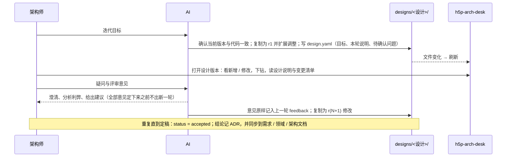

# 专题：描述加载与版本

> 回答：描述文件怎么从磁盘变成可查询的模型；设计版本怎么读、怎么与基线对比。
> 覆盖模块：接入层（ModelSource 插件、描述读取、命令行校验）；模型层的类型与 Schema、加载流水线、版本对比。总览见 [03-architecture.md](../03-architecture.md)，规则见 [02-domain.md](../02-domain.md)（M、E、S5–S13），文件写法见 [04-description-format.md](../04-description-format.md)。

## 1. 分工

```text
磁盘 model/<项目>/…            接入层只搬运原文，不解释含义
   │ readProject / readDesignRevision
   ▼
ModelPayload { files: RawFile[], designs, version?, compare? }
   │ （页面与命令行各自调用，保证两边报错一致）
   ▼
loadModel(files) = load → validate → buildIndex      模型层
   ▼
ModelIndex + Issue[]      ──diffModels(基线, 设计)──▶ ModelDiff（仅设计版本）
```

## 2. 读取（接入层）

| 函数 | 做什么 |
|---|---|
| `resolveModelRoot` | 模型根目录：`ARCH_MODEL_ROOT`，缺省为项目内 `model/`（ADR-0001） |
| `listProjectIds` | 根目录下含 `system.yaml` 的子目录即项目；ID 只允许目录名安全字符，防路径穿越 |
| `readProject` | 读项目当前版本的全部描述文件，**跳过 `designs/`**；附带该项目的设计版本列表 |
| `listDesigns` / `readDesignInfo` | 发现 `designs/<设计>/design.yaml`；格式问题、缺失的轮次快照记入 `problems`，不抛错 |
| `readDesignRevision` | 读设计的某一轮，并附对比基线：当前版本，以及上一轮（若有） |
| `summarizeProject` | 跑一遍 `loadModel`，生成首页卡片的摘要（规模、问题数、顶层、设计版本） |

描述文件扩展名：`.yaml` / `.yml` / `.json`（S8，JSON 与 YAML 走同一解析器）。

### 2.1 端点与事件

| 端点 | 返回 |
|---|---|
| `GET projects.json` | `ProjectSummary[]` |
| `GET models/<项目>.json` | 当前版本的 `ModelPayload`；不存在时 404 |
| `GET models/<项目>/designs/<设计>/<轮次>.json` | 设计某一轮的 `ModelPayload`，带 `compare` |
| ws `arch-model:changed` | `{ project }`；仅开发态，同一项目 150ms 内的多次变化合并为一次（含设计版本目录） |
| `GET source/<项目>…` | 被描述项目的源码清单、文件与导出；仅开发态，见[源码接入与归属 §2.1](./source.md#21-端点) |

开发态由 Vite 插件实时读取；构建态在 `generateBundle` 中把上述 JSON 输出为同名静态文件，页面无需区分。命令行校验 `lint:model` 使用同样的读取函数，逐项目、逐设计轮次校验，`design.yaml` 的问题按 error 计；源码在本地时，当前版本附带归属警告（G9，`readSourceTree` + `sourceIssues`）。

## 3. 加载流水线（模型层）

| 步骤 | 做什么 | 规则 |
|---|---|---|
| `load` | 按路径排序；逐文件解析 YAML / JSON（语法错误整份跳过）、按 JSON Schema 检查格式（未知字段即错误，整份跳过）；合并为 `ArchModel`，每个实体记录出处 `{ file, path, line }`；展开内联子模块；步骤树规整为 `Step`（记录路径与出处，F2）；各文件的 `sourceIgnore` 合并为一个列表（G8） | M1、M2、M10、S2、S8 |
| `validate` | 跨文件检查，不抛异常：error 级实体被剔除，warning 级只去掉坏引用，返回可以安全建索引的模型；场景先清理坏端点、坏引用、重复步骤 id 与成环的 `ref`，再用 `bindRelation` 检查与结构的一致性（校验与回放结果一致） | M3–M9、S5–S6、S11–S12 |
| `buildIndex` | 按 ID 的表（含参与者、场景）；`childrenOf`（层按 `order` 排序）；`pathOf`（根到模块）；出入边表（含参与者）；`scenariosOf`（模块 → 有帧端点在其子树内的场景，R4）；`triggeredBy`（参与者 → 由它触发的场景，A6）；查询 `lowestCommonAncestor`、`nearestExisting`（N5、N11）、`moduleName`、`triggerOf` | R4、A6 |
| `loadModel` | 串起三步并汇总问题；模型层对外唯一的加载入口 | — |

## 4. 设计版本与对比

设计版本的存放与流程见 [ADR-0002](../adr/0002-design-versions.md) 与 [04-description-format.md §5](../04-description-format.md#5-设计版本)：每轮一份完整快照，所以设计版本走与当前版本完全相同的加载流水线，只多一步对比。

`diffModels(base, target) → ModelDiff`（规则 E1、E2）：

- 对模块、关系、接口、数据结构分别按 ID 对齐，得出新增 / 修改（带改动字段）/ 删除；排序为实体类别 → 变更类别 → 声明顺序。
- `touched`：每个目标模型中的模块涉及多少处变更，供画布显示「△N」，引导下钻。
- 对比基线（当前版本 / 上一轮，E3）与基线漂移（E4）由 DeskState 持有和派生，见[视图状态与协调](./view-state.md)。

### 4.1 设计版本的迭代流程



## 5. 数据结构

```ts
interface RawFile { path: string; text: string }          // path 相对项目描述目录

interface ModelPayload {
  project: string; dir: string; files: RawFile[]
  designs?: DesignInfo[]
  version?: { design: string; revision: string }            // 设计版本时给出
  compare?: { current: CompareSource; previous?: CompareSource }  // CompareSource = { label, dir, files }
}

interface ProjectSummary {
  id: string; name: string; description?: string; source?: SourceDef; dir: string
  layered: boolean; top: { id: string; name: string; abstraction?: string }[]
  counts: { modules: number; relations: number; interfaces: number; dataStructures: number; actors: number; scenarios: number }
  errors: number; warnings: number; designs: DesignInfo[]
}

interface DesignInfo {
  id: string; name: string
  status: 'draft' | 'reviewing' | 'accepted' | 'implemented' | 'abandoned'
  goal?: string; base?: { commit?: string; generatedAt?: string }
  revisions: { id: string; date?: string; summary?: string; questions?: string[]; feedback?: string }[]
  problems: string[]
}

interface ArchModel {                       // 实体都带 src { file, path, line }
  system: SystemDef
  modules: ModuleEntity[]                   // 扁平化，带 parentId、seq
  relations: RelationEntity[]               // payload 规整为数组
  interfaces: InterfaceEntity[]; dataStructures: DataStructureEntity[]
  actors: ActorEntity[]; scenarios: ScenarioEntity[]   // 场景的 steps 为规整后的 Step 树
  sourceIgnore: string[]                    // 忽略清单（G8），不参与版本对比
}

interface Issue { severity: 'error' | 'warning'; code: string; message: string; file?: string; path?: string; line?: number }

interface ModelIndex {
  model: ArchModel; rootId: string
  modules / relations / interfaces / dataStructures: Map<string, …>
  childrenOf: Map<string, string[]>; pathOf: Map<string, string[]>
  outRelations / inRelations: Map<string, string[]>
  actors: Map<string, ActorEntity>; scenarios: Map<string, ScenarioEntity>
  scenariosOf: Map<string, string[]>; triggeredBy: Map<string, string[]>
}

interface ModelDiff {
  changes: { entity: 'module' | 'relation' | 'interface' | 'dataStructure'; id: string;
             kind: 'added' | 'changed' | 'removed'; name: string; fields?: string[] }[]
  module / relation / interface / dataStructure: Map<string, Change>   // 仅新增与修改
  touched: Map<string, number>
  counts: { added: number; changed: number; removed: number }
}
```

## 6. 接口

```ts
// 接入层
listProjectIds(modelRoot): string[]
readProject(modelRoot, id, projectRoot): ModelPayload | null
listDesigns(projectDir): DesignInfo[]
readDesignRevision(modelRoot, project, design, revision, projectRoot): ModelPayload | null
listProjects(modelRoot, projectRoot): ProjectSummary[]

// 模型层
loadModel(files: readonly RawFile[]): { index: ModelIndex; issues: Issue[] }    // 纯函数，不抛异常
lowestCommonAncestor(index, a, b): string
nearestExisting(index, path: readonly string[]): string                         // 旧路径中最深的仍存在的模块，否则根
triggerOf(index, scenarioId): string | undefined                                  // A6：第一条消息的发送方
diffModels(base: ModelIndex, target: ModelIndex): ModelDiff
```
