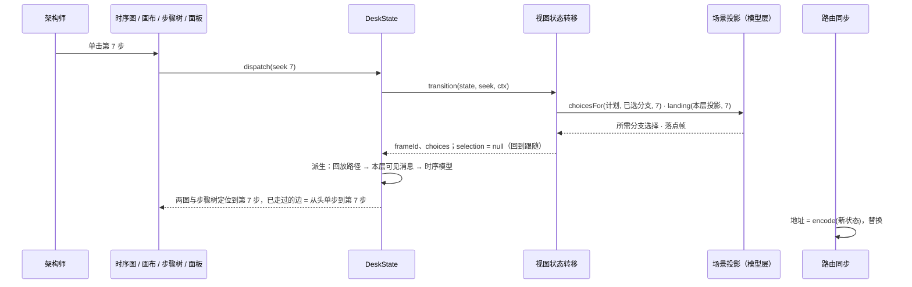

# 专题：视图状态与协调

> 回答：用户此刻在看什么；一次操作怎么改变它；它怎么与路由、描述文件、布局保持一致。
> 覆盖模块：视图状态层的 DeskState（协调者）与视图状态转移（会话规则）。原则见 [03-architecture.md](../03-architecture.md) 原则 6、7；规则见 [02-domain.md](../02-domain.md) 的 V、N、R、F6c、E3、E4。

## 1. 视图状态

视图状态是**一个值**：层次、选中、开关、回放互相约束，不拆成多个 store。

```ts
interface ViewState {
  levelId: string
  selection: Selection | null        // { kind: 'module' | 'relation' | 'edge' | 'actor'; id }
  hover: string | null
  toggles: Toggles                   // showBoundaries · currentOnly · relationTypes · showDiff · compareTo
  playback: PlaybackState | null     // null = 结构视角
}

interface PlaybackState {
  scenarioId: string
  frameId: string | null             // 播放头；null = 停在开头（尚未开始）
  choices: Map<string, number>       // 分支点 → 已选选项
}
```

视角与焦点由状态推出，不另存字段（V1、V2）：

```text
视角 = playback 为 null ? 结构 : 运行
焦点 = 结构视角：selection ?? 当前父模块
       运行视角：selection ≠ null ? 钉住(selection) : 跟随(frameId)
```

回放只由用户驱动（R1），状态里没有「播放中」，也就没有选中与播放头争夺面板的问题：指向对象即钉住（V3），取消选中或移动播放头即回到跟随（V4、V7）。

## 2. 协调者：DeskState

每个项目的每个版本一份，在项目视图组件中创建并注入，生命周期随组件。

| 职责 | 内容 |
|---|---|
| 持有 | `ViewState`（`shallowRef`）、加载后的模型索引与问题、设计信息与对比基线索引 |
| 唯一写入口 | `dispatch(action)`：`transition(state, action, ctx)` 得到新状态与历史标注，写入；对外的操作都是构造动作并 dispatch 的包装 |
| 派生（`computed`，调用纯函数） | 层次视图 `projectLevel`（运行视角下为舞台视图：不受显示开关影响并补齐场景端点，L9、P12）；打开场景时：回放计划 → 回放路径 → 本层帧投影与可见消息 → 时序模型 → 时序图坐标，以及步骤大纲 `outlineScenario` 与参与模块 `scenarioModules`（导航树用，T5、T6）；视角与焦点；钉住对象的参与信息；设计版本的差异 `diffModels` 与基线漂移 |
| 外界同步 | 交给三个同步适配器（§4） |

派生是一条 computed 链：层次或开关变化 → 层次视图 → 帧投影 → 时序模型 → 时序布局。结构图与时序图因此不会不同步。

## 3. 会话规则：视图状态转移

`transition(state, action, ctx) → { state, history: 'push' | 'replace' }`，纯函数，不依赖 Vue、路由；非法动作返回原状态。上下文 `ctx` 提供索引、打开的场景的回放计划、当前层次的舞台视图与本层帧投影。代码在 `src/state/transition/`：`navigation` · `focus` · `playback` · `url`。

| 子模块 | 规则 | 遇到关于被描述系统的问题时调用 |
|---|---|---|
| 视角与焦点 | V1–V4：视角与焦点由状态推出（`perspectiveOf` / `focusOf`）；导航动作在运行视角下即「指向」，钉住对象（下钻钉住被下钻的模块）；取消选中回到跟随 | — |
| 导航 | N1–N13：下钻、跳转、返回上级、选中、定位、Esc / Backspace、重新加载与切换版本后的回退；跳转与定位只在层次改变时进历史（N10） | `nearestExisting`（N5、N11）、`nearestVisibleLevel`（N12）、`lowestCommonAncestor`（N3） |
| 回放 | R1、R5、R6、R10、R12、R13、V7：打开场景（停在开头，播放头为空）、退出、单步（回到跟随）、指向、选分支；重新加载后场景失效则退出 | `stepAfter` / `stepBefore`（R7）、`landing`、`choicesFor`（R13）、`chooseBranch`（F6b）、`resolvePath`（F6） |
| URL 编解码 | N6、N10、F6c、R10、R12：状态 ↔ 查询参数；解码时丢弃无效值，恢复到最接近的合法状态：带有效步骤时停在该步；同一场景已打开且没带步骤时保留原播放头；只有场景时停在开头 | `choiceList` / `choicesFromList`（F6c）、`planScenario` |

| 查询参数 | 含义 | 进历史 |
|---|---|---|
| `level` | 当前层次（根层省略） | 下钻、跳转：是 |
| `sel` | 选中，`m:` / `r:` / `e:` / `a:` 前缀 | 否 |
| `sc` | 场景（有即运行视角） | 打开场景：是 |
| `step` | 播放头帧 ID | 否 |
| `alt` | 已选分支：路径上依次经过的分支点的选项序号，以 `.` 连接（如 `0.1`） | 否 |

## 4. 同步适配器

外界始终是状态的投影；外界的变化转成动作交给 `dispatch`。每个适配器都可用假对象单测。

| 适配器 | 状态 → 外界 | 外界 → 动作 |
|---|---|---|
| 路由同步 | 地址 = `encode(state)`，按历史标注 push / replace | 后退、前进、改地址、打开分享链接 → `decode` → `restore` |
| 模型源同步 | — | 取描述文件 → `loaded`；本项目 `arch-model:changed` → 重新取 → `reloaded` |
| 布局同步 | 层次视图变化 → 调用 `layoutView` | 布局完成 → 回填定位结果（序号过期则丢弃） |

**路由回声**：路由导航是异步的。自己发起的导航完成前，路由变化一律视为回声、不回写状态；否则双击（两次选中 + 一次下钻）时旧地址会覆盖新层次。离开本项目或本版本的路由时也不回写。

## 5. 关键时序

### 5.1 打开项目或版本


### 5.2 下钻、选中、定位

- **双击下钻**：`dispatch(drill X)` → N1 判定可下钻 → 层次 = X、清空选中（N2）→ 进历史（N10）→ 派生、布局（命中缓存则立即返回）→ 画布适应。
- **单击选中**：`dispatch(select)`，不重新投影、不重新布局，只替换地址。
- **定位关系**（聚合边面板中点原始关系）：`dispatch(revealRelation r)` → 层次 = 两端的最近公共祖先 → 选中 r（N3）。

### 5.3 描述变化或切换版本

AI 改写描述 → ModelSource 推送 → 模型源同步重新取并 `dispatch(reloaded)` → 导航规则保留层次与选中，失效时退到最近仍存在的祖先（N5）→ 重新派生；有错误时问题提示列出。切换版本时路由带上当前 `level` / `sel`，新版本按同样规则恢复（N11）。

### 5.4 运行视角

**指向某一步（R13）**——时序图消息、结构图步骤序号、步骤树、运行信息里的步骤都走这一条：



- **回放中双击下钻**（V3、R6、R7）：`drill` 在运行视角下钉住被下钻的模块；层次视图变化 → 帧重新投影，本层可见消息变细；`frameId` 不变，两图停在同一帧。
- **单步到分支点**（F6）：`dispatch(next)` 走到下一条可见消息；其后已无可见消息（路径在未选分支处截止）时回放控制条展开全部选项，「下一步」不可用 → `dispatch(chooseBranch)` → 路径延长，继续单步。
- **取消选中**（V4）：Esc 或单击空白 → `selection = null`，焦点回到跟随。单步、拖动进度同样回到跟随（V7）。

## 6. 动作与接口

```ts
type ViewAction =
  | { type: 'loaded' | 'reloaded' } | { type: 'restore'; query: Record<string, string> }
  | { type: 'drill'; id } | { type: 'goTo'; id; select? } | { type: 'goUp' }
  | { type: 'select'; selection } | { type: 'revealRelation'; id } | { type: 'revealModule'; id }
  | { type: 'hover'; id } | { type: 'toggle'; patch: Partial<Toggles> }
  | { type: 'openScenario'; id } | { type: 'closeScenario' }
  | { type: 'next' } | { type: 'prev' } | { type: 'seek'; frameId }
  | { type: 'chooseBranch'; pointId; option }

createDeskState(fetchModel: () => Promise<ModelPayload>, options?: { project?: string; version?: VersionRef }): DeskState
// DeskState：state（只读）、index、issues、派生数据、dispatch、init()、attachRouter(router)，以及操作：
//   drillInto · goTo · goUp · select · revealRelation · revealModule · setHover
//   openScenario · closeScenario · next · prev · seek · chooseBranch
// 派生：view · positioned · perspective · focus · playback · scenario · plan · path · scenarioView · home
//       currentIndex · walked · frame · sequence · positionedSequence · pinnedParticipation · outline · scenarioModules

transition(state: ViewState, action: ViewAction, ctx: TransitionContext): { state: ViewState; history: 'push' | 'replace' }
// TransitionContext: { index: ModelIndex; plan?: ScenarioPlan; levelView?: LevelView; scenarioView?: ScenarioLevelView }
perspectiveOf(state): 'structure' | 'run'
focusOf(state): { kind: 'selection' | 'pinned'; selection } | { kind: 'level'; levelId } | { kind: 'follow'; frameId }
encodeView(state: ViewState, index: ModelIndex, plan?: ScenarioPlan): Record<string, string>
// 解码即 transition(state, { type: 'restore', query }, ctx)：丢弃无效值，恢复到最接近的合法状态
keyIntent(state, index, key: 'Escape' | 'Backspace'): ViewAction | 'leave' | null      // N7、N9；'leave' = 回项目列表
```
