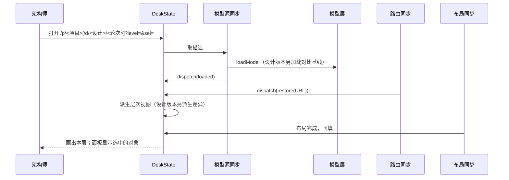
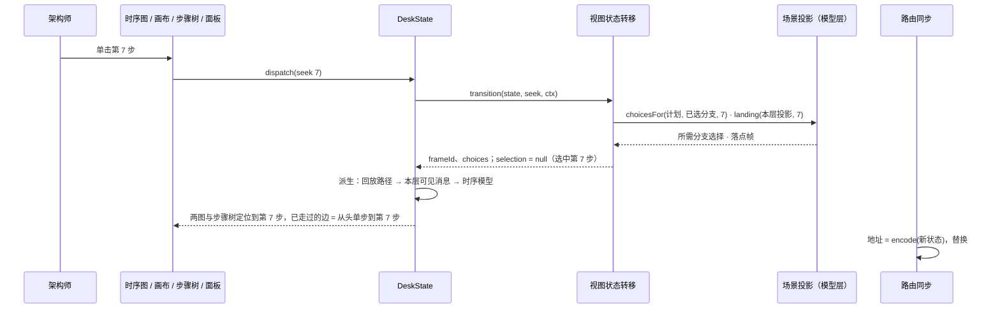

# 专题：视图状态与协调

> 回答：用户此刻在看什么；一次操作怎么改变它；它怎么与路由、描述文件、布局保持一致。
> 覆盖模块：视图状态层的 DeskState（协调者）与视图状态转移（会话规则）。原则见 [03-architecture.md](../03-architecture.md) 原则 6、7；规则见 [02-domain.md](../02-domain.md) 的 V、N、R、F6c、F6e、E3、E4、G9、G14、G16。

## 1. 视图状态

视图状态是**一个值**：层次、选中、开关、回放互相约束，不拆成多个 store。

```ts
interface ViewState {
  levelId: string
  selection: Selection | null        // 显式选中的对象 { kind: 'module' | 'relation' | 'edge' | 'actor' | 'file' | 'dep'; id }（文件的 id 为相对源码根目录的路径；dep 为代码依赖叠加线，id 为 `<依赖方模块>-><被依赖方模块>`，K10）；运行视角下为 null 即选中进度所在的步骤 / 场景
  hover: string | null
  toggles: Toggles                   // showBoundaries · currentOnly · relationTypes · showDiff · compareTo · showFacts（代码事实叠加，K9）
  playback: PlaybackState | null     // null = 结构 / 交互视角（按 mode）
  mode?: 'structure'                 // 不开场景时的画布模式：'structure' 为结构视角，缺省（不写）为交互视角；URL `v=s`（V11）
}

interface PlaybackState {
  scenarioId: string
  frameId: string | null             // 进度（播放头）；null = 在开头（尚未开始）
  choices: Map<string, number>       // 分支点 → 已选选项
}
```

视角与选中由状态推出，不另存字段（V1、V2、V7）：

```text
视角 = playback ≠ null ? 运行 : (mode = 'structure' 且不在草图画布 ? 结构 : 交互)
选中 = selection ≠ null ? selection
       运行视角：frameId ≠ null ? 步骤(frameId) : 场景(scenarioId)
       结构 / 交互视角：无（面板显示当前父模块，N13）
```

> 第七轮（ADR-0031）：不开场景时的视角是视图状态里的**模式值** `ViewState.mode`（`'structure'` 为结构，不写为交互），进 URL（`v=s` 为结构视角，交互不写），切换进历史；打开场景即运行视角，退出回到进入前的模式（V11）。结构与交互之间切换时层次、节点位置与开关不变，只换边与角标；选中映射：关系与视图边 → 同一对节点同方向的依赖边（`dep`，没有依赖时清空），端口 → 定义模块，依赖边切回交互视角时仍为 `dep`（V12）。DeskState 另派生结构视角的本层依赖边、影响面与指标（K14–K17、U15–U17）。

选中是唯一的主语（ADR-0012）。步骤与场景不存进 `selection`：运行视角下 `selection` 为空即「选中进度所在的步骤」，进度在开头时即「选中场景」。不变式「选中的步骤就是进度所在的一步」（V7）因此由表示本身保证——单步、指向、拖动进度只需移动 `frameId` 并清空 `selection`；选中其他对象只设 `selection`，进度不动；取消选中（V4）就回到进度所在的步骤。

URL 与此一致，编码不需区分：选中步骤时只有 `step`；选中场景时既无 `sel` 也无 `step`；选中其他对象时 `sel` 与表示进度的 `step` 并存。

选中突出（R15、R16）同样由状态推出：

```text
突出 = 结构 / 交互视角：无
       选中步骤：selected = 它所在的可见消息，paired = 配对帧（F7）所在的可见消息；本层不可见时为空
       选中模块 / 文件（归属模块）/ 关系（两端）/ 视图边（两端）/ 参与者：lanes = lanesOf(…)，即突出的泳道
       选中场景：无
```

时序图按 `selected` 画选中样式、按 `paired` 加浅色「配对」标记、按 `lanes` 突出泳道头与生命线；`selected` 为空时进度所在消息只在序号旁加小标记。交互图只在 `selected` 不为空时把不属于 `selected` / `paired` 的走过的边变灰。

舞台的交互关系显示方式（V8）与「在画布上显示」（V9）只属于画布这块界面，和副栏页签一样留在呈现层，不进视图状态与 URL。

源码（文件清单、归属）与代码事实（文件依赖、基线、拦截记录）不是视图状态：它们是关于被描述系统的数据，像模型索引一样由协调者持有、由源码同步取得。副栏的页签与预览文件只属于那块界面，留在呈现层（G15）。

- **端口、组装与场景类别**（ADR-0029、ADR-0030）：选中多一种「端口」（`sel=p:<接口 ID>`，L13、V2）；「组装」叠加开关同热度开关，按项目记在本地、不进 URL（O12）；场景列表的「主流程 / 全部」切换记在本地（R17）。

## 2. 协调者：DeskState

每个项目的每个版本一份，在项目视图组件中创建并注入，生命周期随组件。

| 职责 | 内容 |
|---|---|
| 持有 | `ViewState`（`shallowRef`）、加载后的模型索引与问题、设计信息与对比基线索引、源码清单 `SourcePayload` |
| 唯一写入口 | `dispatch(action)`：`transition(state, action, ctx)` 得到新状态与历史标注，写入；对外的操作都是构造动作并 dispatch 的包装 |
| 派生（`computed`，调用纯函数） | 选中 `selectedOf`（V2）与选中突出 `emphasisOf`（R15、R16，泳道取自时序模型的 `lanesOf`）与调用返回配对 `pairReturns`（F7）；路线 `routeOf`（F6f）；层次视图 `projectLevel`（运行视角下为舞台视图：不受显示开关影响并补齐场景端点，L9、P12）；打开场景时：回放计划 → 回放路径 → 本层帧投影与可见消息 → 时序模型 → 时序图坐标，以及步骤大纲 `outlineScenario` 与参与模块 `scenarioModules`（导航树用，T5、T6）；视角；选中对象（非步骤、非场景）的参与信息；设计版本的差异 `diffModels` 与基线漂移；源码：归属 `assignFiles`、目录树 `fileTree`、选中模块的文件 / 入口、选中文件的归属模块与本层投影 `fileNodes`（G14）、归属警告 `sourceIssues`（只在当前版本并入问题列表，G9）；架构治理：治理报告 `governanceReport`、交互视角开关开启时的本层投影 `levelFacts`（K9、Y4）、门禁错误 `gateIssues`（并入问题列表，U9）、选中叠加线的 `depsBetween`（K10）、拦截摘要 `summarizeLedger`（Q4）；人确认层：各模块的确认状态与差异 `reviewStates`、范围与计数（Z3–Z5） |
| 外界同步 | 交给四个同步适配器（§4） |
| 对外的形状 | 核心平铺：视图状态与直接推出的层次、选中、视角、开关、层次视图与坐标、`playback`，以及全部操作；领域派生分四组，代码在 `src/state/desk/`（ADR-0013）：`desk.run` 运行视角、`desk.files` 源码、`desk.versions` 设计版本、提交版本与对比、`desk.facts` 架构治理（ADR-0015）、`desk.review` 人确认层（Z） |

派生是一条 computed 链：层次或开关变化 → 层次视图 → 帧投影 → 时序模型 → 时序布局。画布与时序图因此不会不同步。层次视图只依赖层次、显示开关与打开的场景，悬停、选中、进度变化不会引起重新投影与重新排布（ADR-0009）。

## 3. 会话规则：视图状态转移

`transition(state, action, ctx) → { state, history: 'push' | 'replace' }`，纯函数，不依赖 Vue、路由；非法动作返回原状态。上下文 `ctx` 提供索引、打开的场景的回放计划、当前层次的舞台视图与本层帧投影。代码在 `src/state/transition/`：`navigation` · `selected` · `playback` · `url`。

| 子模块 | 规则 | 遇到关于被描述系统的问题时调用 |
|---|---|---|
| 视角与选中 | V1–V4、V7、R15、R16、G16：视角与选中由状态推出（`perspectiveOf` / `selectedOf`）；导航动作在运行视角下即「指向」，选中对象（下钻选中被下钻的模块）；取消选中即回到进度所在的步骤；选中突出 `emphasisOf` | `lanesOf`（R15、R16） |
| 导航 | N1–N13：下钻、跳转、返回上级、选中、定位、Esc / Backspace、重新加载与切换版本后的回退；跳转与定位只在层次改变时进历史（N10） | `nearestExisting`（N5、N11）、`nearestVisibleLevel`（N12）、`lowestCommonAncestor`（N3） |
| 回放 | R1、R5、R6、R10、R12、R13、V7、F6e：打开场景（停在开头、选中场景）、退出、单步与指向（选中那一步并移动进度）、选分支（任何分支点；进度不在新路径上时停在分支点之前；选中不变）；重新加载后场景失效则退出 | `stepAfter` / `stepBefore`（R7）、`landing`、`choicesFor`（R13）、`chooseBranch`（F6b）、`choicesForBranch` / `pointPrefix`（F6e）、`resolvePath`（F6） |
| URL 编解码 | N6、N10、F6c、R10、R12：状态 ↔ 查询参数；解码时丢弃无效值，恢复到最接近的合法状态：带有效步骤时停在该步；同一场景已打开且没带步骤时保留原进度；只有场景时停在开头 | `choiceList` / `choicesFromList`（F6c）、`planScenario` |

| 查询参数 | 含义 | 进历史 |
|---|---|---|
| `level` | 当前层次（根层省略） | 下钻、跳转：是 |
| `sel` | 选中，`m:` / `r:` / `e:` / `a:` / `f:` 前缀（`f:` 后为文件路径，G16）；选中步骤或场景时没有 | 否 |
| `sc` | 场景（有即运行视角） | 打开场景：是 |
| `step` | 进度帧 ID；没有 `sel` 时即选中这一步；与 `sel` 都没有时选中场景 | 否 |
| `alt` | 已选分支：路径上依次经过的分支点的选项序号，以 `.` 连接（如 `0.1`） | 否 |

## 4. 同步适配器

外界始终是状态的投影；外界的变化转成动作交给 `dispatch`。每个适配器都可用假对象单测。

| 适配器 | 状态 → 外界 | 外界 → 动作 |
|---|---|---|
| 路由同步 | 地址 = `encode(state)`，按历史标注 push / replace | 后退、前进、改地址、打开分享链接 → `decode` → `restore` |
| 模型源同步 | — | 取描述文件 → `loaded`；本项目 `arch-model:changed` → 重新取 → `reloaded` |
| 布局同步 | 层次视图变化 → 调用 `layoutView` | 布局完成 → 回填定位结果（序号过期则丢弃） |
| 源码同步 | — | 进入项目、描述重新加载、用户刷新 → 经注入的 `SourceFetcher`（项目视图注入 `httpSourceFetcher`）取 `source/<项目>.json`（404 或取数失败为 `error`，带原因，G1）；文件内容与导出按路径按需取、按清单版本缓存（[源码接入与归属 §2.1](./source.md#21-端点)）；清单取到后随代码事实一起取 git 历史 `source/<项目>/history.json`（J1） |

**路由回声**：路由导航是异步的。自己发起的导航完成前，路由变化一律视为回声、不回写状态；否则双击（两次选中 + 一次下钻）时旧地址会覆盖新层次。离开本项目或本版本的路由时也不回写。

## 5. 关键时序

### 5.1 打开项目或版本



### 5.2 下钻、选中、定位

- **双击下钻**：`dispatch(drill X)` → N1 判定可下钻 → 层次 = X、清空选中（N2）→ 进历史（N10）→ 派生、布局（命中缓存则立即返回）→ 画布适应。
- **单击选中**：`dispatch(select)`，不重新投影、不重新布局，只替换地址。
- **定位关系**（聚合边面板中点原始关系）：`dispatch(revealRelation r)` → 层次 = 两端的最近公共祖先 → 选中 r（N3）。

### 5.3 描述变化或切换版本

AI 改写描述 → ModelSource 推送 → 模型源同步重新取并 `dispatch(reloaded)` → 导航规则保留层次与选中，失效时退到最近仍存在的祖先（N5）→ 重新派生；问题页签的返工清单随之重算。切换版本时路由带上当前 `level` / `sel`，新版本按同样规则恢复（N11）。

### 5.4 运行视角

**指向某一步（R13）**——时序图消息、交互图步骤序号、步骤树、运行信息里的步骤都走这一条：



- **回放中双击下钻**（V3、R6、R7）：`drill` 在运行视角下选中被下钻的模块；层次视图变化 → 帧重新投影，本层可见消息变细；`frameId` 不变，两图停在同一帧。
- **单步到分支点**（F6）：`dispatch(next)` 走到下一条可见消息；其后已无可见消息（路径在未选分支处截止）时回放控制条展开全部选项，「下一步」不可用 → `dispatch(chooseBranch)` → 路径延长，继续单步。
- **直选分支**（F6e）：时序图的分支条件、路线总览、步骤树的分支标题都发 `dispatch(chooseBranch)` → 分支点不在路径上时 `choicesForBranch` 补齐到达它的选择 → 进度仍在新路径上则不动，否则停在 `pointPrefix` 的最后一帧（取其可见消息的第一帧），没有则回到开头；选中不变（选中的是步骤时随进度移到新落点，V7）。
- **取消选中**（V4）：Esc 或单击空白 → `selection = null`，即选中进度所在的步骤（在开头时为场景）；已经是它时 Esc 无动作（N9）。单步、拖动进度同样清空 `selection`，选中移动后的那一步（V7）。
- **返回上级**（N8）：`goUp` 在父层选中退出来的模块，运行视角下原来选中的步骤或文件随之取消，进度不动。

## 6. 动作与接口

```ts
type ViewAction =
  | { type: 'loaded' | 'reloaded' } | { type: 'restore'; query: Record<string, string> }
  | { type: 'drill'; id } | { type: 'goTo'; id; select? } | { type: 'goUp' }
  | { type: 'select'; selection } | { type: 'revealRelation'; id } | { type: 'revealModule'; id }
  | { type: 'hover'; id } | { type: 'toggle'; patch: Partial<Toggles> }
  | { type: 'openScenario'; id } | { type: 'closeScenario' }
  | { type: 'next' } | { type: 'prev' } | { type: 'seek'; frameId }
  | { type: 'chooseBranch'; pointId; option }

createDeskState(fetchModel: () => Promise<ModelPayload>, options?: { project?: string; version?: VersionRef; source?: SourceFetcher }): DeskState
// SourceFetcher: { tree(): Promise<SourcePayload>; file(path): Promise<SourceFile | null>; exports(path): Promise<ExportedSymbol[] | null> }；缺省为没有源码来源（清单为 `error`，只看描述的测试用），项目视图注入 `httpSourceFetcher`
// DeskState（ADR-0013）：
//   核心：state（只读）· status · loadError · index · issues · allIssues · modelDir · levelId · levelPath · selection · selected · hoverId
//         perspective · toggles · view · positioned · levelVersion · playback · project · version
//   操作：dispatch · init · reload · attachRouter · watchChanges · pressKey
//         drillInto · goTo · goUp · select · selectFile · revealRelation · revealModule · setHover · setToggles
//         openScenario · closeScenario · next · prev · seek · chooseBranch
//   run：scenario · plan · path · scenarioView · home · currentIndex · walked · frame · branchPoint · frameLevel · overlay
//        sequence · positionedSequence · pairs · route · emphasis · stageParticipants · participation · outline · participants
//   files：payload · ownership · tree · lines · maxLines · selected · owners · hits · moduleFiles · warnings
//          filesOf(id) · entryOf(id) · exportMatch(id, symbols) · entryModulesOf(path) · file(path) · exports(path) · refresh()
//   versions：designs · design · revision · commits · commit · baseCommit · baselines · baseline · diff · drift

transition(state: ViewState, action: ViewAction, ctx: TransitionContext): { state: ViewState; history: 'push' | 'replace' }
// TransitionContext: { index: ModelIndex; plan?: ScenarioPlan; levelView?: LevelView; scenarioView?: ScenarioLevelView }
perspectiveOf(state): 'structure' | 'run'
emphasisOf(state, ctx: EmphasisContext): Emphasis | null                               // 选中突出（R15、R16）；结构 / 交互视角为 null
// EmphasisContext: { index; levelView; scenarioView; sequence; pairs: ReturnPairs | null; fileOwners: readonly string[] }
// Emphasis: { selected: number | null; paired: ReadonlySet<number>; lanes: ReadonlySet<string> }   // 选中消息、配对消息（可见消息序号）、突出的泳道（视图节点 ID）
selectedOf(state): Selected | null                     // Selected = Selection | { kind: 'step'; id: frameId } | { kind: 'scenario'; id }；null = 结构 / 交互视角无选中
encodeView(state: ViewState, index: ModelIndex, plan?: ScenarioPlan): Record<string, string>
// 解码即 transition(state, { type: 'restore', query }, ctx)：丢弃无效值，恢复到最接近的合法状态
keyIntent(state, index, key: 'Escape' | 'Backspace'): ViewAction | 'leave' | null      // N7、N9：Esc 只取消选中，Backspace 返回上级；'leave' = 回项目列表
```

## 7. 草图画布的会话（ADR-0025）

> 状态：已实现。草图下的会话按**设计**一份、一条设计级撤销栈；草图画布独立于模型画布（不经投影与 elk）。

打开草图版本即进入草图画布（X7a）。状态分两处，各管各的：

| 状态 | 在哪 | 为什么 |
|---|---|---|
| 正在编辑什么 `editing: SketchTarget \| null`（`{ kind: 'design'; design }` 或 `{ kind: 'persistent'; id }`）；层次 `levelId` 为当前张的挂载点（根挂载为系统根） | 视图状态 `ViewState` | 与视角、文件选中互斥，要和它们在同一个值里由转移函数约束；下钻与面包屑只换层次（`openSketch`，不进浏览器历史）；不进 URL |
| 编辑会话 `EditSession`：一个设计的全部草图（文件里读到的与会话里推出的）、各文件读取时的指纹、当前张、一条设计级撤销栈、已过时 | DeskState 的 `edit` 组 | 一次编辑会话的内容，与浏览的层次、选中只经「影响」相互作用；不进 URL，换成命令行也不需要（原则 3） |

- **会话规则**（`transition/edit.ts`）：`enterEdit { target, level }` / `exitEdit`（退出回到进入草图之前的版本由呈现层经路由完成，#20b）与互斥（X7a：其下打开场景、模型画布的层次导航、选中文件 / 依赖线 / 耦合线 / 聚合边、打开代码事实与演化叠加为无效动作）；`openSketch { level }`（下钻与面包屑切张）；`edited { effects, previousPath, level }`——改名（含前缀级联）换成新 ID、删除清空选中、新建 / 合并 / 拆分选中结果、撤销到别的张时层次跟过去（X7h、X7g）；`leaveGuard(脏) → 放行 / 需要确认`。信息条「退出」有未保存改动时三选保存 / 放弃 / 取消；切换版本、回项目列表、浏览器前进后退同样三选（X7a）；关闭页面受 `beforeunload` 限制为浏览器的两选确认。
- **编辑会话的纯函数**（`desk/edit/session.ts`）：`begin(target, id, 读到的各张与指纹)`、`open(mount)`（下一层草图不存在时按「基线子树 + 血缘」推出，X18；不进撤销栈，推出且未改动的不算脏）、`apply(ops)`（调用模型层 `applyDesignEdit(草图集合, op, ctx)`，几个操作原子地成一步，记前后的文档与当前张）、`splitImpact(op)`（拆分前的二次确认范围，不改会话：随原模块删掉的下一层草图与模块数，下一层还没出现时按基线推出计入，X7k）、`renameImpact(op)`（表单改 ID 提交前的影响，不改会话：试算设计级改名，列后代数、关系数、随之改名的下一层草图、当前版本里的引用；`renameHasImpact` 为假时直接应用，X7d）、`undo` / `redo`（深度上限 200）、`saved`、`reloaded`、`replay`、`discard`。「脏」= 任一张与读取时不同（推出的与此刻推出的结果比结构、与出现时比位置，X20）。
- **派生**（`desk/edit/derive.ts`）：设计的索引（各张草图序列化后与 `system.yaml`、持久草图、引用的外部模块一起加载，作为草图画布下 DeskState 的 `index`）；当前张的画布数据（草图布局 `sketchScene`：模块、根草图的层带、由关系派生并折叠的引用节点——非根草图按所属层成列、带框线与中心区，层的顺序与模块所属的层取设计的索引，X22——直线边，本层模块的位置取草图 `layout`，没有时按中心区的可用区域网格布局一次、不写回，X15、X19、X21；「隐藏外部引用」是编辑分组里只在会话里的开关 `hideReferences`，只影响画布数据；画布的可用区域 `area` 由草图画布用 ResizeObserver 量出、经 `setArea` 写入编辑分组，也只在会话里，X22）；各张的两级校验（X14）、待重连（X16）、超七（X13）；两个对比（相对基线 / 相对当前版本，本张与全设计，X17；持久草图只有相对当前版本，即偏差、同 `sketchCheck`；另派生交给 AI 时的改动摘要 `handoff`，对象为去掉它贡献后的当前版本，只进「说明」、不进计数）；脏、能否撤销 / 重做、面包屑。
- **同步**（`desk/edit/save.ts`）：保存整个设计，经注入的 `ModelWriter.saveDesignSketches` 一次发出改过的草图与各自指纹（推出且改过的为新文件、级联改名的带 `renamedFrom`、删掉的列入 `removed`），写前丢掉没有关系的引用并列出（X19）；只拦格式错误；409 → 已过时，可重新加载并重放（X7i）；持久草图走单张写回。`saveAndHandToAi` = 没有格式错误与语义提示时先保存、重新读入，再取载荷里的指令（X20）。

```ts
interface EditSession {
  target: { kind: 'design'; design: string } | { kind: 'persistent'; id: string }
  id: string                                           // 设计 ID 或持久草图 ID
  read: Record<string /* 读取时的 mount */, { file: string; hash: string; def: SketchDef }>
  doc: { sketches: Record<string /* mount */, SketchDef>; origin: Record<string, string>; born: Record<string, SketchDef> }
  mount: string                                        // 当前张
  past: Step[]; future: Step[]                         // Step: { ops: DesignEditOp[]; before; after; effects; mountBefore; mountAfter }
  stale: boolean
}
// desk.edit：{ session, active, mount, sketch, scene, validation(s), designErrors, designWarnings, pending, overSevens, vsBaseline, vsCurrent, comparison,
//   compareMode, twoBases, dirty, canUndo, canRedo, breadcrumb, sheets, parent, notice, saving,
//   enter, exit, run, edit(op), addModule, connect, merge, split, demote, promote, moveIn, rename, moveNode, relabel, autoArrange, addReference,
//   setAbstraction, remove, previewRemove, openChild, openMount, undo, redo, save, saveAndHandToAi, discard, replayOnReload, createDesign, canLeave }
```
